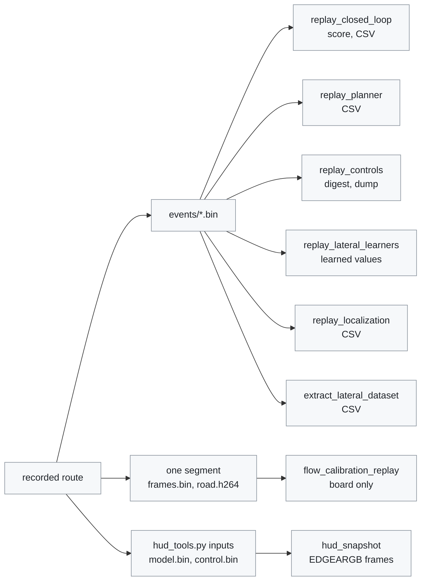

# Diagnostic tools

[← Documentation](../docs/README.md)

Analysis, replay and benchmark tools kept outside the runtime path. They are not
in the default build; [`CMakeLists.txt`](CMakeLists.txt) builds them when
`EDGEPILOT_BUILD_DIAGNOSTICS=ON`. The unit tests and the Python checks
(`check_*.py`) are in [`../tests/`](../tests/README.md).

Most tools read a `recordd` route. This map shows what each tool reads and what
it writes:



`hud_snapshot` also draws synthetic scenes without any input, and
`alert_sound_preview` needs no input at all.

## Build

The host tools build without the AX runtime, the MaixCAM2 SDK or OpenCV:

```sh
cmake -S . -B build-host \
  -DCMAKE_BUILD_TYPE=Release \
  -DEDGEPILOT_BUILD_RUNTIME=OFF \
  -DEDGEPILOT_BUILD_DIAGNOSTICS=ON
cmake --build build-host --target replay_closed_loop -j2
```

For the board, add `-DEDGEPILOT_BUILD_DIAGNOSTICS=ON` when configuring
`build-ax630/` in the container from `tools/docker_ax630/`, and the same tools
appear in `build-ax630/bin`. `build.sh` takes no options, so configure inside
the container by hand. The only board-only tool is `flow_calibration_replay`
(it uses the VDEC and the IVE).

## Tools

The replay tools read `recordd` recordings (`events/*.bin`).

### Host

| Tool | Usage | What it does |
| --- | --- | --- |
| `replay_closed_loop` | `[options] <out.csv\|-> <events.bin...>` | Replays the lateral control loop in closed loop, with the car's response simulated. `--lane-filter W` is the lane-line time filter's weight for the new measurement (1 turns it off, [Lane-line filter](../docs/lane-line-filter.md)). `--lateral-nn m.json` loads the learned torque model for a `--steering` file with `nn_feedforward` on. |
| `replay_planner` | `[--laneless\|--lane] [--exact] [--vehicle] [--steering s.json] [--lane-filter W] <out.csv> <events.bin...>` | Runs `LateralPlanner` again on the recorded `ModelState`/`ControlState` and writes the desired curvature to a CSV. `--laneless` or `--lane` forces that mode whatever the parameter file says. `--steering` loads a parameter file, such as the route's `params/steering.json` snapshot (the code defaults without it). `--vehicle` feeds the recorded blinkers, driver torque and blind spot (from the CAN, skipping the Panda's echoes as controlsd does) and the recorded active flag; without it the planner sees no blinker and no driver, so lane changes never run. `--exact` writes every `LateralTarget` field and the lag-adjusted curvature bit for bit (`%a`), for comparing before and after a refactor. `--lane-filter` is the lane-line time filter's weight for the new measurement (1 turns it off) |
| `replay_controls` | `[--steering s.json] [--cruise c.json] [--vehicle-json j] [--force-engaged] [--lead-track track.txt] [--lane-filter W] [--lateral-nn m.json] [--dump out.txt] <events.bin...>` | Feeds a recording through the logic of one controlsd tick (`ControlsTick`) at 10 ms ticks, writes a digest of the CAN to send, the `ControlState` and the learner outputs, and compares them with the recorded `ControlState`. The same code gives bit-identical output, so it is used to compare before and after a controlsd refactor. `--lead-track` fills `ModelState.lead_track` by frame number for routes recorded before v13 (a lead track made off-line, one line per frame: `frame_id valid flags distance relative_speed distance_std speed_std`). The cruise state is estimated from the driver's SET/RES, so to look at the cruise, start the replay before that session begins. `--lane-filter` is the lane-line time filter's weight for the new measurement (1 turns it off). `--lateral-nn` loads the learned torque model (a route keeps its own as `models/lateral_nn.json`), which takes effect only when the `--steering` file turns `nn_feedforward` on; with the switch on and no model, the tool warns. |
| `replay_lateral_learners` | `[options] <events.bin...>` | Runs the paramsd and torqued learners on a recording and prints the learned values |
| `replay_localization` | `<out.csv> <events.bin...>` | Feeds a recording, in recorded order, through the same code as the board's `locationd` (the pose Kalman filter and lagd), writes one CSV row per IMU batch, and at the end prints a yaw-rate comparison against the CAN and the lagd result. It needs a recording with IMU records |
| `extract_lateral_dataset` | `<out.csv> <events.bin...>` | One CSV row per `ControlState`, records read in time order. The CAN is decoded by the same `vehicle_can` as the runtime |
| `hud_snapshot` | `[--model m.bin] [--control c.bin] [--iterations N] [--out PREFIX] [--portrait [--flip-x] [--flip-y]]` | Draws 27 HUD scenarios at the same 640x480 as `overlayd` into `EDGEARGB` frames (`PREFIX_<scenario>.argb`), and prints the drawing time over N iterations (50 by default). `--model` and `--control` draw a recorded `ModelState`/`ControlState` pair (from `tools/ui/hud_tools.py inputs`) instead. `--portrait` draws into the portrait 480x640 buffer with a transpose, as the board does, and `--flip-x`/`--flip-y` add the board's axis flips. Time it on the board |
| `alert_sound_preview` | `[--out PREFIX]` | Writes the `overlayd` alert sounds with the same synthesis code to `PREFIX_<name>.wav` (48 kHz mono, 100% volume) |

### Board

| Tool | Usage | What it does |
| --- | --- | --- |
| `flow_calibration_replay` | `<segment_dir> [--open frames.txt] [--leads leads.txt]` | Decodes one recorded segment with the VDEC, feeds it through the same optical-flow work as `modeld` (`FlowTracker`, IVE), and prints the result of each accepted calibration window, one line for each frame that gave a lead expansion rate, and the final estimate and timing. `--open` is a list of the frame numbers where the conditions were open (without it every frame counts as a straight road; with an empty file the calibration does not run). `--leads` gives, per frame, the lead from the previous model output and the warp calibration (`number time valid probability x y roll pitch yaw camera_height offset`). It does not use the IVPS, so it works while the runtime runs, but see the warning below |

> [!WARNING]
> After several `flow_calibration_replay` runs beside the runtime, creating the
> VDEC once failed a kernel memory allocation (order 4), and an `imud` I2C call
> then rebooted the board with a kernel Oops (2026-10-11). Stop edgepilot for
> long runs.

## `replay_closed_loop`

The tool turns the lane geometry the recording saw back into car coordinates by
how far the simulated car has drifted from it (`dy`, `dpsi`), so a control
change really makes the car move differently. Ticks with driver torque, or
inactive ticks, resynchronise to the recorded state, so every free-running
stretch starts from the real pose.

- Plant: `--wn`, `--zeta`, `--delay`, `--gain G` (all speed nodes) or
  `--gain-pts a,b,c,d`.
- Controller: `--sad` (steer_actuator_delay), `--kp`, `--ki`, `--laf`.
- Driver intervention hysteresis: `--driver-high`, `--driver-low`,
  `--driver-release`.
- `--open-loop`: stops the pose correction, to see only how well the plant
  reproduces the recorded drive.
- `--steering route/params/steering.json`: the tuning at the time of the
  recording (including the path mode). The recording's LearnerState learned
  values (paramsd, torqued) go into the controller as in controlsd, and the
  inverse steering-angle model uses the same learned values.
- `--camera-shift D`: shifts the model output as if the camera mount offset
  differed from the recording by D m.
- `--torque F,O,R`: substitutes torqued values (factor, offset, friction) to see
  the behaviour once they are valid.
- In laneless mode no lane holds the position, so the closed loop diverges
  (2 m clamp). Use it only in Lane mode.

It prints the reproduction score (overall and per speed band) on standard
output. Give `-` as the output path when no CSV is needed. Plant identification
and how to read the score are in
[Closed-loop replay](../docs/closed-loop-replay.md).

## `replay_lateral_learners`

The tool calls the same `LateralLearners` as controlsd. The active flag and the
torque sent come from `ControlState`; driver intervention comes from the
recorded driver torque, debounced as the controller does it.

- `--steering route/params/steering.json`: uses the tuning at the time of the
  recording (priors, delay, input source). Without it the code defaults apply,
  which may differ from the board.
- `--vehicle-json route/params/live_parameters.json`: starts from the paramsd
  saved values.
- `--source steering|locationd|esp`: the yaw-rate and roll source for paramsd
  and torqued. The default (`steering`) follows
  `use_locationd_learner_inputs` and, as controlsd does, falls back to ESP12
  when locationd is more than 0.5 s stale or its filter is invalid.
- `--metric-from N`: counts the curvature comparison printed at the end from
  file N (counted from 0). The earlier files only serve to converge the
  learning.
- `--upstream-schedule`: observes the steering angle and speed only at 20 Hz,
  as upstream does (the default is every tick).
- `--fit-all`: uses every point for the torqued fit (the default is 2000 random
  points, as upstream).
- `--torque-cache c.bin`: restores it when it exists and overwrites it at each
  save tick, to chain several drives like the runtime cache.
- `--inputs`/`--torque-inputs` keep each tick's inputs and
  `--outputs`/`--torque-outputs` the published messages, for comparing with a
  reference implementation.

## Writing a tool

- The Korean `//` comment at the top of the file says what the tool is for and
  gives its usage on a `사용:` line.
- Input files are positional arguments; options are `--name value` or `--name`
  without a value. An unknown option prints the usage
  (`flow_calibration_replay` still ignores one).
- A usage error exits with code 2; a run error, where an input cannot be read or
  a result does not match, exits with 1.

## Related

- [Diagnostics](../docs/diagnostics.md): procedures and results for HUD
  snapshots, NV12 replay, model swap verification, lateral bias, dataset
  extraction, and the planner and control-tick replays
- [Closed-loop replay](../docs/closed-loop-replay.md): plant identification and
  the score of `replay_closed_loop`
- [Lane-line filter](../docs/lane-line-filter.md): the filter that
  `--lane-filter` weighs
- [Lateral NN](../docs/lateral-nn.md): the torque model that `--lateral-nn`
  loads
- [Flow calibration](../docs/flow-calibration.md): the calibrator that
  `flow_calibration_replay` runs
- [Recording](../docs/recording.md): the route layout the replay tools read
- [Host tests](../tests/README.md): the unit tests and Python checks
- [Build and deploy](../docs/build-and-deploy.md): the host and board builds
