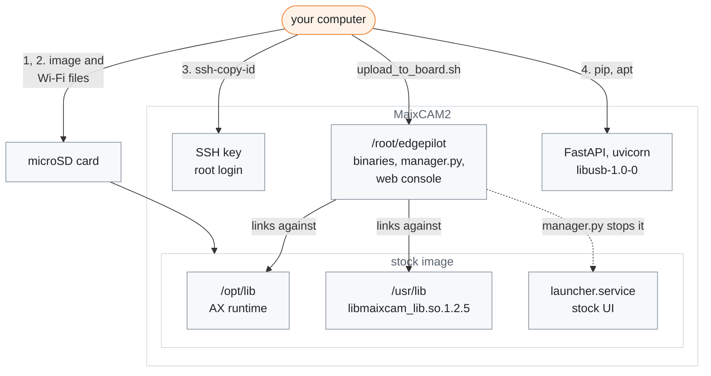

# Board setup

[← Documentation](README.md)

How to prepare a Sipeed MaixCAM2 for the runtime: the stock system image, its
Wi-Fi, SSH access and the packages the web console and `pandad` need. The
runtime runs on the stock image as Sipeed ships it, and the build copies the
libraries it links against from the board
([Build and deploy](build-and-deploy.md)).

What this guide and the first upload put on the board, and what the runtime
uses from the stock image:



The board and its stock image:

| Item | Value |
| --- | --- |
| SoC | AX630C, 2x Cortex-A53 + NPU, 1 GB |
| Storage | microSD card (the 1 GB board has no eMMC) |
| Camera | `ov_os04d10`, opened at 1280x720 NV12 |
| LCD | 480x640 portrait panel, used as 640x480 landscape: VO turns the camera layer 90°, and the HUD is drawn portrait ([HUD](hud.md#two-layers)) |
| OS | Ubuntu 22.04 arm64, MaixPy v4.12.5 image |
| AX runtime | `/opt/lib` (`libax_engine`, `libax_sys`, `libax_ivps`, ...) |
| Camera/display library | `/usr/lib/libmaixcam_lib.so.1.2.5` |
| Install directory | `/root/edgepilot` |

## 1. Flash the stock image

Skip this step on a board that already runs the stock image. The runtime is
built and tested on `maixcam2-2026-06-01-maixpy-v4.12.5_sd.img` (its
`/boot/ver` reads `maixcam2-2026-05-29-maixpy-v4.12.5`). A newer image may ship
other libraries: `fetch_maixcam2_sdk.sh` copies what the board has, and
`upload_to_board.sh` installs the `libmaixcam_lib` 1.2.5 the build links
against.

Sipeed lists the images on its [MaixCAM2 system flashing page][sipeed-os],
with downloads from [MEGA][sipeed-mega] and Baidu Netdisk (the extraction code
is on that page). An image over 2 GB comes split
as `.img.7z.001`, `.002`, ...; download every part and extract from the first:

```sh
7z x maixcam2-2026-06-01-maixpy-v4.12.5_sd.img.7z.001
```

Pick the file by the board's storage:

| Board | File | How |
| --- | --- | --- |
| 1 GB, no eMMC, boots from the microSD card (this project's board) | `..._sd.img` | write it to the card with Etcher, Raspberry Pi Imager or `dd`; this erases the card |
| with eMMC | `....img` | flash it over USB or from a TF card while holding the boot/Func button, as Sipeed's page describes |

On an eMMC board with a damaged boot partition, Sipeed's page flashes the
`.axp` image with AXDL on Windows instead.

The first boot of a fresh image expands the root file system and can stay on
the logo for minutes: on 2026-09-25 it took about 9 minutes and a reboot
before the stock UI showed. A fresh image also needs the steps in
[Boot time](boot-time.md#after-a-reflash) once the runtime is uploaded.

## 2. Set the Wi-Fi before the first boot

The card's first partition is FAT32 (128 MiB), so any computer opens it with a
card reader; on the board it is `/boot`. At every boot `wifi.service` runs the
image's `wifi.sh`, which reads these files from it:

| File | Effect |
| --- | --- |
| `wifi.sta` | an empty file: join a network as a client |
| `wpa_supplicant.conf` | the networks to join, copied to `/etc/wpa_supplicant.conf`; it takes precedence over the next two |
| `wifi.ssid`, `wifi.pass` | one network's name and password, used when there is no `wpa_supplicant.conf` |
| `wifi.ap` | instead of `wifi.sta`: the board makes its own network, `maixcam2-<id>` with the password `maixcam2`, and sits at `10.<x>.<y>.1` |

Without `wifi.sta` or `wifi.ap`, `wifi.sh` falls back to the root file
system's `/etc/wpa_supplicant.conf` or a built-in test network. The
`maix_wifi_*` lines in `configs` are for Sipeed's own apps; `wifi.sh` does not
read them.

To join a phone hotspot first and a home network otherwise, with the card's
first partition mounted at `<boot>`:

```sh
touch <boot>/wifi.sta
cat > <boot>/wpa_supplicant.conf <<'EOF'
ctrl_interface=/var/run/wpa_supplicant
network={
	ssid="<phone hotspot>"
	psk="<password>"
	priority=2
}
network={
	ssid="<home network>"
	psk="<password>"
	priority=1
}
EOF
```

Save the files with Unix line endings: a Windows carriage return becomes part
of the network name or the password. While the card is out, you can also set
`maix_npu_ai_isp=1` in `configs` (the stock file has the line with `0`).
`camerad` needs it, and setting it now saves the reboot after
`install_autostart.sh` ([The stock launcher](#the-stock-launcher)).

## 3. Install your SSH key

The scripts log in as `root` with key authentication. Find the board's
address on your network: once the runtime runs, a tap on the HUD's status pill
opens a network card with its IPv4 address ([HUD](hud.md#touch)); before that,
look it up in your router's client list. Install your public key once:

```sh
ssh-copy-id root@<board-ip>
```

The scripts take the board as their first argument, or from
`EDGEPILOT_BOARD` when it is set, and stop with their usage when neither is
given:

```sh
export EDGEPILOT_BOARD=root@<board-ip>
```

## 4. Install the packages

The web console needs FastAPI and uvicorn. `upload_to_board.sh` copies their
requirements file into the install directory, so run this on the board after
the first upload ([Build and deploy](build-and-deploy.md)):

```sh
python3 -m pip install -r /root/edgepilot/requirements-web-console.txt
```

`pandad` links `libusb-1.0`; install `libusb-1.0-0` on the board if it is
missing. Check the `libmaixcam_lib.so` link after any apt run
([Troubleshooting](#troubleshooting)).

## The stock launcher

The stock UI (`launcher.service`) and the apps it starts from `/maixapp/apps/`
use about 30% CPU and hold the camera and NPU. `manager.py` stops both before
starting the runtime unless `EDGEPILOT_STOP_LAUNCHER=0`. It does not restart
them on exit; `systemctl start launcher.service` brings the stock UI back.

`scripts/install_autostart.sh` disables the launcher at boot and starts the
runtime in its place ([Boot autostart](runtime.md#boot-autostart)). It also
writes `maix_npu_ai_isp=1` into `/boot/configs`, which splits the NPU at boot;
`camerad` refuses to start without it, so reboot the board once after the
script first writes it.

## Things to avoid

- **Do not build the runtime on the board.** A native build runs out of the
  1 GB memory. Build in the container described in
  [Build and deploy](build-and-deploy.md).
- **Do not walk the whole filesystem.** A walk such as `find /` makes the
  kernel remount `/` read-only on the stock rootfs. Search specific directories
  instead ([Troubleshooting](#troubleshooting)).
- **Do not copy over a running binary.** It cannot be overwritten.
  `upload_to_board.sh` handles this by uploading into `.upload/` and moving the
  files into place; copy by hand the same way.

## Troubleshooting

### `camerad` and `overlayd` fail to start

The board's apt/ldconfig can repoint `/usr/lib/libmaixcam_lib.so` to a `_bak`
file, and then `camerad` and `overlayd` fail to start. Restore the link:

```sh
ln -sfn libmaixcam_lib.so.1.2.5 /usr/lib/libmaixcam_lib.so
```

### The root filesystem turned read-only

The stock rootfs has ext4 directory-checksum defects under `/usr/share/doc`. A
whole-filesystem walk such as `find /` hits them and the kernel remounts `/`
read-only. The defects are fixed with an offline `e2fsck -fD` on the root
partition (SD card in another machine, filesystem unmounted).

## Related

- [Build and deploy](build-and-deploy.md): fetching the board libraries,
  building, and the upload
- [Boot time](boot-time.md): the boot tuning, and what a freshly flashed image
  needs
- [Runtime](runtime.md): the manager, the boot service and the stock launcher
- [Runtime options](runtime-options.md): `EDGEPILOT_STOP_LAUNCHER` and the
  other switches
- [Scripts](../scripts/README.md): the scripts used above

[sipeed-os]: https://wiki.sipeed.com/hardware/en/maixcam/maixcam2_os.html
[sipeed-mega]: https://mega.nz/folder/1tolGbba#ki5_NgGIc_omAv0zRU19Lg
