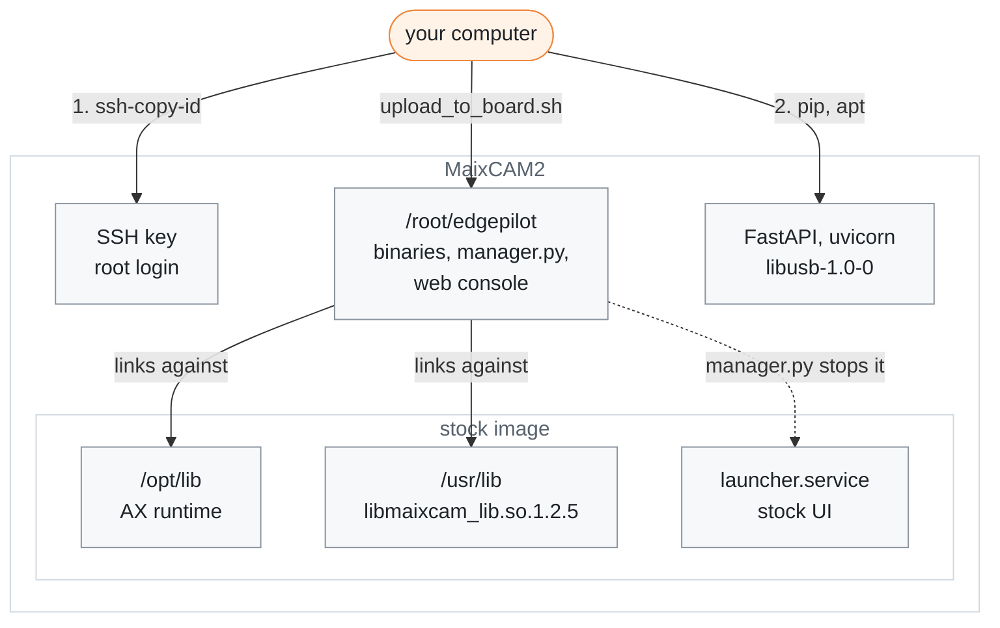

# Board setup

[← Documentation](README.md)

How to prepare the stock Sipeed MaixCAM2 image for the runtime: SSH access and
the packages the web console and `pandad` need. Nothing is reflashed: the image
already carries what the binaries link against, and the build copies those
exact files from the board ([Build and deploy](build-and-deploy.md)).

What this guide and the first upload add to the stock image, and what the
runtime uses from it:



The board and its stock image:

| Item | Value |
| --- | --- |
| SoC | AX630C, 2x Cortex-A53 + NPU, 1 GB |
| Camera | `ov_os04d10`, opened at 1280x720 NV12 |
| LCD | 480x640 portrait panel, used as 640x480 landscape: VO turns the camera layer 90°, and the HUD is drawn portrait ([HUD](hud.md#two-layers)) |
| OS | Ubuntu 22.04 arm64 |
| AX runtime | `/opt/lib` (`libax_engine`, `libax_sys`, `libax_ivps`, ...) |
| Camera/display library | `/usr/lib/libmaixcam_lib.so.1.2.5` |
| Install directory | `/root/edgepilot` |

## 1. Install your SSH key

The scripts log in as `root` with key authentication; the default board address
is `192.168.219.117`. Install your public key once:

```sh
ssh-copy-id root@192.168.219.117
```

`fetch_maixcam2_sdk.sh` and `upload_to_board.sh` take the board as their first
argument when the address differs.

## 2. Install the packages

The web console needs FastAPI and uvicorn. `upload_to_board.sh` copies their
requirements file into the install directory, so run this on the board after
the first upload ([Build and deploy](build-and-deploy.md)):

```sh
python3 -m pip install -r /root/edgepilot/requirements-web-console.txt
```

`pandad` links `libusb-1.0`; install `libusb-1.0-0` on the board if it is
missing. Check the `libmaixcam_lib.so` link after any apt run
([Troubleshooting](#troubleshooting)).

## The stock launcher

The stock UI (`launcher.service`) and the apps it starts from `/maixapp/apps/`
use about 30% CPU and hold the camera and NPU. `manager.py` stops both before
starting the runtime unless `EDGEPILOT_STOP_LAUNCHER=0`. It does not restart
them on exit; `systemctl start launcher.service` brings the stock UI back.

`scripts/install_autostart.sh` disables the launcher at boot and starts the
runtime in its place ([Boot autostart](runtime.md#boot-autostart)). It also
writes `maix_npu_ai_isp=1` into `/boot/configs`, which splits the NPU at boot;
`camerad` refuses to start without it, so reboot the board once after the
script first writes it.

## Things to avoid

- **Do not build the runtime on the board.** A native build runs out of the
  1 GB memory. Build in the container described in
  [Build and deploy](build-and-deploy.md).
- **Do not walk the whole filesystem.** A walk such as `find /` makes the
  kernel remount `/` read-only on the stock rootfs. Search specific directories
  instead ([Troubleshooting](#troubleshooting)).
- **Do not copy over a running binary.** It cannot be overwritten.
  `upload_to_board.sh` handles this by uploading into `.upload/` and moving the
  files into place; copy by hand the same way.

## Troubleshooting

### `camerad` and `overlayd` fail to start

The board's apt/ldconfig can repoint `/usr/lib/libmaixcam_lib.so` to a `_bak`
file, and then `camerad` and `overlayd` fail to start. Restore the link:

```sh
ln -sfn libmaixcam_lib.so.1.2.5 /usr/lib/libmaixcam_lib.so
```

### The root filesystem turned read-only

The stock rootfs has ext4 directory-checksum defects under `/usr/share/doc`. A
whole-filesystem walk such as `find /` hits them and the kernel remounts `/`
read-only. The defects are fixed with an offline `e2fsck -fD` on the root
partition (SD card in another machine, filesystem unmounted).

## Related

- [Build and deploy](build-and-deploy.md): fetching the board libraries,
  building, and the upload
- [Boot time](boot-time.md): the boot tuning, and what a freshly flashed image
  needs
- [Runtime](runtime.md): the manager, the boot service and the stock launcher
- [Runtime options](runtime-options.md): `EDGEPILOT_STOP_LAUNCHER` and the
  other switches
- [Scripts](../scripts/README.md): the scripts used above
