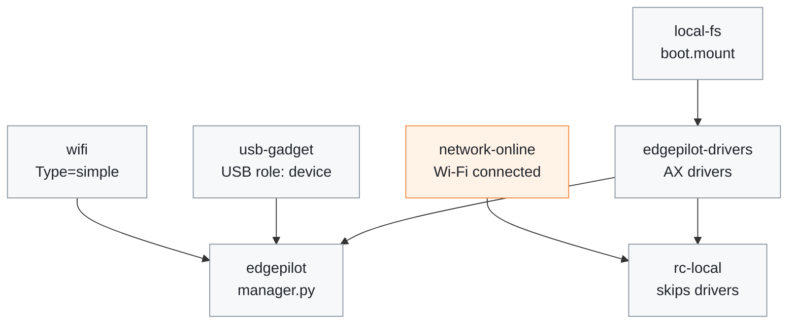

# Boot time

[← Documentation](README.md)

How long the MaixCAM2 takes from power-on to the first model output, and what
`scripts/install_boot_tuning.sh` changes on the stock image to shorten it. Read
it after a reflash, or when the board starts slowly.

Power-on to the first model output in seconds of uptime: the stock boot on the
original SD card, and the tuned boot on its replacement
([Measured](#measured)):

```mermaid
gantt
    dateFormat x
    axisFormat %-S s
    tickInterval 5second
    todayMarker off
    section Stock
    first model output at about 33 s :0, 33000
    section Tuned
    kernel :0, 1200
    userspace, AX drivers :1200, 6600
    edgepilot to camerad :6600, 7200
    first model frame :7200, 8500
    up to 9 s :active, 8500, 9000
```

## Why the stock image starts late

- **The AX drivers load from `rc.local`.** Debian's drop-in puts
  `rc-local.service` after `network-online.target`, so the drivers (and with
  them edgepilot) wait for Wi-Fi to connect. Loading them needs only
  `/boot/configs` (the CMM size) and `/soc/ko`.
- **Unused services start at the same time.** tailscale, nginx, ttyd,
  maixvision, avahi-monitor, bluetooth and rsyslog share the slow SD card and
  the two CPUs with the runtime.
- **The persistent journal grows.** It had reached about 700 MB, and the
  dhclient of the unplugged `eth0` and avahi-monitor wrote to it every few
  seconds.

## What the tuning changes

`scripts/install_boot_tuning.sh [root@board]` takes effect at the next boot.
`--remove` undoes all of it.

- Installs `scripts/edgepilot-drivers.service`, which loads the AX media drivers
  and starts the NPU bandwidth limiter at the start of boot. The `rc.local` line
  is guarded so it skips the drivers when they are already loaded (the original
  is kept as `/etc/rc.local.edgepilot-orig`).
- Disables tailscaled, nginx, ttyd, maixvision-server and avahi-monitor, and
  masks bluetooth, rsyslog and `syslog.socket` (they would otherwise come back
  over D-Bus or a socket).
- Turns off hotplug DHCP on `eth0` (`ifup eth0` still works).
- Caps the journal at 64 MB.
- Sets `RebootWatchdogSec=30s`. A reboot that hangs in systemd-shutdown then
  resets after 30 s instead of 10 minutes.

### Unit order

The boot units around edgepilot, named without `.service` and `.target`. An
arrow points from the unit that starts first. `rc-local.service` still waits
for Wi-Fi, but nothing of edgepilot waits for it any more:

- `edgepilot-drivers.service` runs only when `ax_sys` is not loaded yet, and
  needs only `/boot/configs` and `/soc/ko`, not the network.
- `scripts/edgepilot.service` starts after `edgepilot-drivers.service` and
  `usb-gadget.service` (which sets the USB role to device before the manager
  switches it to host).
- It does not wait for the network: the web console listens on `0.0.0.0`, so
  the Wi-Fi may connect later. It is ordered after `wifi.service`, which is
  `Type=simple` and so costs nothing at boot, so that it stops before the
  Wi-Fi clean-up. Reboots hung in systemd-shutdown without that order (twice on
  2026-10-01).
- `wifi-dhcp-renew.service` is bound to `wifi.service` and starts after it.

## Measured

On the original SD card (2015, about 3.9 MB/s writes) the first model output
came at about 33 s of uptime:

- 11–17 s in the kernel, mostly an ext4 journal replay on every boot;
- about 10 s of I/O-bound sysinit;
- about 6 s waiting for `rc-local`.

After the card was replaced (SanDisk Ultra 32 GB, 2026-10-02), with the tuning
installed:

| Stage | Uptime |
| --- | --- |
| Kernel done | 1.2 s |
| Userspace done, AX drivers loaded, edgepilot starts | 6.6 s |
| `camerad` starts | 7.2 s |
| First model frame | about 8.5–9 s |

Most of the old kernel time was the card. The rest of the gain is the early
driver load and the services that no longer start.

## After a reflash

A freshly flashed v4.12.5 image needs three things before the runtime runs:

1. `scripts/upload_to_board.sh` installs `libmaixcam_lib` 1.2.5. The image's
   library of the same size is a different build, and `camerad` crashes with
   it.
2. `scripts/install_autostart.sh` adds the missing final newline to
   `/boot/configs` before appending `maix_npu_ai_isp=1`. The setting takes
   effect at the next boot, and `camerad` refuses to start until then.
3. `scripts/install_boot_tuning.sh` installs the boot tuning above.

## Related

- [Board setup](board-setup.md): SSH, the packages, and what to avoid on the
  stock image
- [Build and deploy](build-and-deploy.md): the upload and its `libmaixcam_lib`
  install
- [Runtime](runtime.md): what the manager starts once `edgepilot.service` runs
- [Scripts](../scripts/README.md): the install scripts and the systemd units
