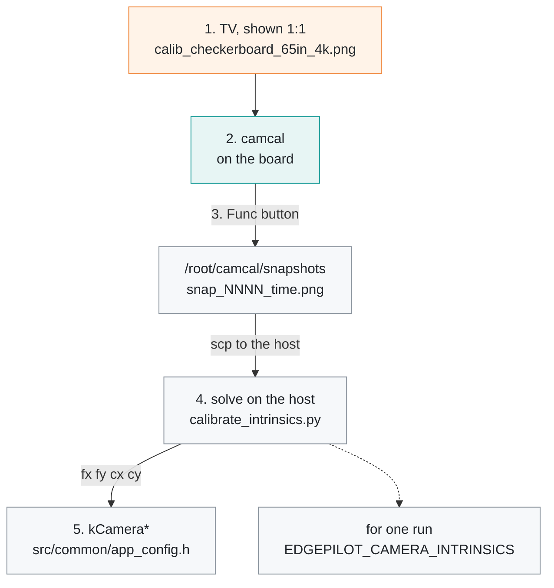
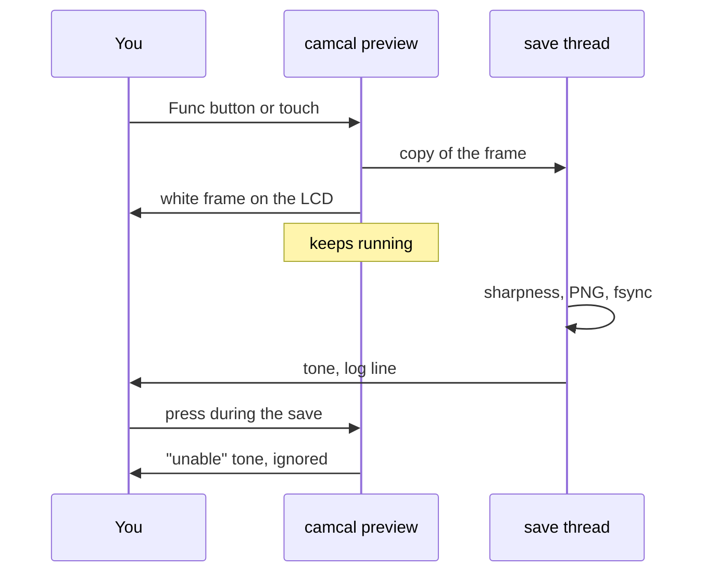

# Camera intrinsics

[← Documentation](README.md)

How to measure the MaixCAM2 camera's pinhole intrinsics (`fx fy cx cy`) from
photos of a checkerboard shown on a 65" 4K TV. The runtime uses these values for
the model input warp and the HUD projection (`src/common/app_config.h`
`kCamera*`, given at 1920x1080); the last section holds the measurement they
come from.

From the target on the TV to the constants in the runtime:



## 1. Set up the TV

`tools/camera/calib_checkerboard_65in_4k.png` is 3840x2160 with 18 x 9 squares
of 180 px, which gives 17 x 8 inner corners. Each square is 67.45 mm on a 65"
panel. Regenerate it with `tools/camera/make_calibration_target.py` for another
panel.

The pattern is only a rigid lattice if the TV shows it pixel for pixel:

- Show it 1:1 in PC/Game mode, with overscan off (`Just Scan` / `Screen Fit`).
- Set sharpness to 0, and turn off dynamic contrast, local dimming and motion
  interpolation.
- Use moderate brightness, and keep room lights off the glossy panel.

## 2. Start `camcal`

`camcal` opens the camera through the same `MaixCamera` path as the runtime, so
the geometry matches:

- It uses the full 2560x1440 sensor field scaled to 1920x1080, with no crop.
- The board `cam_flip` and `cam_mirror` settings apply, and AI-ISP is on as in
  the runtime.

The LCD shows the whole frame at its original 16:9 aspect, with black bars above
and below. The top bar shows the number of saved shots. The bottom bar shows
`SAVING...` and the sharpness figure of the last shot.

`scripts/install_autostart.sh` installs `camcal.service`, which never starts at
boot. Start it as a service. This stops the driving runtime, which has to give
up the camera:

```sh
ssh root@192.168.219.117 systemctl start camcal
```

To run it in the foreground over SSH instead, run
`systemctl stop edgepilot && /root/edgepilot/camcal`. Enter or space then also
takes a shot, and `q` quits.

## 3. Take the shots

- **Shutter:** press the **Func** button, or tap the touchscreen. The screen
  flashes a white frame when the shot is taken, and a tone plays once the PNG is
  on disk.
- **Busy:** saving takes about 1.5–2.5 s, and the preview keeps running
  meanwhile. A press during a save is refused with the "unable" tone.
- **Files:** they go to `/root/camcal/snapshots/snap_NNNN_<time>.png`.
  Numbering continues from the files already there.

What one shot does:



The MaixCAM2 lens covers about 80 x 51 degrees, which sets these distances:

| Goal | Distance |
| --- | --- |
| Board (1214 x 607 mm) spans the frame width, so its corners reach the image corners | about 0.75 m |
| Whole TV fills the frame width | about 0.85 m |
| Board covers 40–45% of the width, to place it in each region of the frame | about 1.6–1.8 m |

- Keep the whole board inside the frame. A board clipped by the edge is not
  detected.
- Take several close shots with the board near the image corners. They
  constrain the distortion terms.
- Take far shots with the board in each corner, at each edge and in the centre.
- Tilt the camera about ±30° on both axes and roll it a little. Frontal views
  alone do not separate focal length from distance.
- Brace the camera. The sensor has a rolling shutter, and hand motion shears the
  board.
- 20–30 usable shots is plenty. If moiré appears, change the distance slightly.

Each saved shot is logged with its Laplacian-variance sharpness:

```text
camcal: 3 saved /root/camcal/snapshots/snap_0003_20260926_101500.png sharp=812 write=1600ms
```

Discard shots whose `sharp=` is much lower than the rest. Those are blurred or
motion-smeared.

When done, run `systemctl stop camcal && systemctl start edgepilot`.

## 4. Solve

Copy the shots to the host and solve. The solver needs `opencv-python` and
`numpy`.

```sh
scp -r root@192.168.219.117:/root/camcal/snapshots ./camcal_snapshots
python3 tools/camera/calibrate_intrinsics.py camcal_snapshots \
    --corners 17x8 --square-mm 67.45 --max-view-error 0.5 --json intrinsics.json
```

The solver prints `fx fy cx cy` at the capture size, the difference from the
runtime `kCamera*`, the field of view, the distortion terms, and the worst
views.

## 5. Update the runtime

The runtime warp is pinhole only. Put the four numbers, which are at 1920x1080,
into `src/common/app_config.h` `kCamera*`. They can also be set per run with
`EDGEPILOT_CAMERA_INTRINSICS=fx,fy,cx,cy`.

## `camcal` options

Environment variables, for a foreground run:

| Variable | Default | Meaning |
| --- | --- | --- |
| `CAMCAL_DIR` | `/root/camcal/snapshots` | Output directory |
| `CAMCAL_WIDTH` / `_HEIGHT` | `1920` / `1080` | Capture size (the whole sensor field, scaled) |
| `CAMCAL_FORMAT` | `png` | `png` (lossless) or `jpg` |
| `CAMCAL_MAX_SHUTTER_US` | `10000` | Auto-exposure limit. It is shorter than the runtime's 33 ms because hand-held shots smear |
| `CAMCAL_INPUTS` | `/dev/input/event0,/dev/input/event1` | Shutter devices (Func key, touchscreen) |

## 2026-09-26 measurement

The TV showed a 12 x 7 checkerboard (11 x 6 inner corners, `--corners 11x6`,
`tools/camera/chessboard_3840x2160_12x7_280px.png`) instead of the 18 x 9
target. The intrinsics do not depend on the pattern size. These values are now
the runtime `kCamera*`.

- 58 shots taken, 54 detected.
- Views over 0.8 px reprojection error were dropped, leaving 42 views at
  0.52 px RMS.
- The full result is in `tools/camera/intrinsics_20260926.json`.

| | Measured (1920x1080) | Bootstrap 1σ | Earlier value (stock camera app) | Difference |
| --- | --- | --- | --- | --- |
| `fx` | 1131.24 | ±2.1 | 1132.33 | -1.09 (-0.10%) |
| `fy` | 1130.85 | ±2.0 | 1131.47 | -0.62 (-0.05%) |
| `cx` | 940.13 | ±2.6 | 932.80 | **+7.33 (+0.79%)** |
| `cy` | 552.60 | ±1.7 | 556.06 | -3.46 (-0.62%) |

- **Focal length:** it matches the earlier values within the measurement
  error. `fx` and `fy` agree to 0.03%, as square pixels should.
- **Principal point:** `cx` differed by about 2.8σ, which is 0.37° of yaw. The
  online calibration had absorbed most of that as a yaw offset.
- **Stability:** dropping views barely moves the result. Keeping all 54 gives
  fx 1131.8 and cx 942.3; a 0.6 px cut (31 views) gives fx 1129.8 and cx 939.4.
- **Field of view:** 80.6 x 51.0°.
- **Distortion:** `k1 -0.0090 k2 +0.0135 p1 -0.0010 p2 +0.0002 k3 -0.0210`. The
  pinhole-only warp ignores it, which costs 2.6 px on average and 19.7 px at
  worst (in the image corners).
- **Distortion inside the model inputs:** almost all of that error is in the
  image corners, which the model does not use. Inside the input windows the
  error is 0.09 px mean and 0.5 px max for the road model, and 0.18 / 1.0 px
  for the wide model (model pixels), so the GDC `LDC_PERSPECTIVE` mode is not
  worth enabling yet.

## Related

- [Model pipeline](model-pipeline.md): the input warp that uses the intrinsics
- [HUD](hud.md): the lane projection on the LCD
- [Flow calibration](flow-calibration.md): the camera mount's angles, measured
  on the road
- [Runtime options](runtime-options.md): `EDGEPILOT_CAMERA_INTRINSICS` and the
  other switches
- [Board setup](board-setup.md): the SSH access the commands above use
