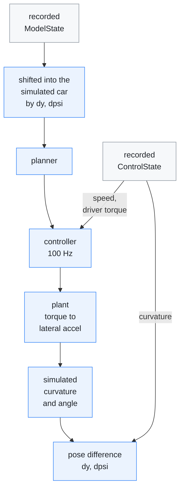
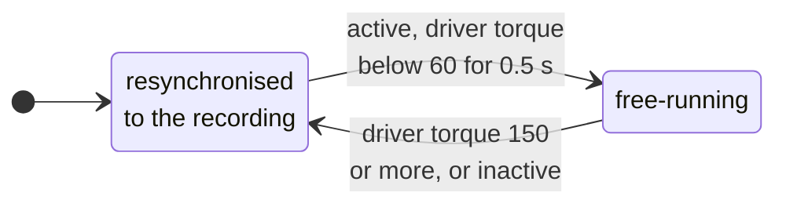

# Closed-loop replay

[← Documentation](README.md)

`diagnostics/replay_closed_loop.cc` replays a recording with the car's
response simulated, so a control change moves the car instead of being scored
against a frozen recording. Use it to rank controller and planner settings on
recorded drives before they reach the road.

Each step of the replay, from a recorded model frame to the simulated car's
drift:



The loop closes in two places: the simulated steering angle goes back into the
controller on the next tick, and the pose difference moves the next model frame.

## Why

`replay_planner` holds the car's response at whatever the recording captured.
Change a gain and the measured curvature does not move, so the error the
controller sees is fiction, and an offline prediction can point the opposite
way from the road.

The missing piece is not graphics, it is the plant. Curvature to the car's
pose is already in the code (`TorqueController::estimate_actual_curvature`);
only torque to lateral acceleration was missing.

## How

### Pose correction

The recorded perception is reused, not re-rendered. The simulated car
accumulates a pose difference against the recorded car,

```text
dpsi' = v * (k_sim - k_rec)
dy'   = v * dpsi
```

and every model frame (the plan, the lane lines and the road edges) is rotated
and translated into the simulated car's frame before the planner sees it. Real
camera output, real model output, closed loop.

This holds while the deviation stays inside what the camera saw. A 2 m clamp
on `|dy|` (and 0.15 rad on `|dpsi|`) guards against reading the model's lines
beyond that.

### Resynchronising

Driver torque and inactive ticks are disturbances the simulation cannot
reproduce. Those ticks resynchronise to the recording, and the next
free-running segment starts from the real pose.

The driver gate has hysteresis: 150 counts in, 60 counts and 0.5 s out. Driver
torque is noisy even hands-off, so a single threshold shatters a drive into
hundreds of sub-second segments; the hysteresis keeps the free-running
segments long.



### Plant

Torque to lateral acceleration, as a pure delay and a second-order lag. The DC
gain is `1/kf`, the assumption the feedforward is already built on, times a
speed-scheduled correction for the error in that assumption.

The default plant is `wn = 10 rad/s`, `zeta = 4`, `delay = 0`, with this gain,
identified on MaixCAM2 lane drives (2026-10-04, [Evidence](#evidence)):

| Speed | 3 m/s | 8 m/s | 15 m/s | 25 m/s |
| --- | --- | --- | --- | --- |
| Gain | 1.05 | 0.525 | 1.05 | 1.80 |

The plant is accepted on **closed-loop reproduction**, not on an open-loop fit.
Run with `--open-loop`, the perception is exactly what the car saw and the
controller feeds back the simulated angle. If the plant is right, the
simulated lateral acceleration tracks the recorded one.

### Metrics

`lane_y` is the lane-centre offset in the simulated car's frame. Unlike `dy`, it
does not refer to the recorded trajectory, so it does not favour whichever
configuration produced the recording. Use it for A/B, with the tracking error
and the fraction of ticks the rate limit binds.

### Running it

```sh
replay_closed_loop [options] <out.csv|-> <events.bin...>
```

The options are listed in
[Diagnostic tools](../diagnostics/README.md#replay_closed_loop). A 24-minute
drive replays in under a second on an M5. A sweep of 840 plant candidates over
a 6-minute drive takes about 30 s at 8-way parallelism.

## Evidence

**Identification.** An earlier attempt to identify the plant by fitting
recorded torque against recorded angle gave `tau = 2210 ms` at 14% explained,
and was not usable. The default came from scaling an earlier gain curve and
reading the open-loop R²:

| Lane route | R² peaks at | R² |
| --- | --- | --- |
| 2026-10-04 | 1.5× | 0.960 → 0.971 |
| 2026-10-03 | 1.7-2.0× | 0.956 → 0.977 |

So the default is the 1.5× curve.

**Feedforward factor.** With the earlier curve, raising the controller's
`lat_accel_factor` to the torqued estimate (3.15) looked like a 12 cm push to
the outside of left curves. With the re-identified plant the same change is
neutral (RMS 0.109 → 0.110 m).

The DC gain is fixed relative to `torque_lat_accel_factor` in the route's
`steering.json`. So **a feedforward factor can only be ranked with a plant
identified on the same car setup**. Check the open-loop R² against a gain
scale before trusting such a comparison.

## Limits

**What the numbers support.**

- A naive model that assumes the car follows the requested curvature exactly
  already explains most of the variance. Judge a plant by how much of the
  remaining error it removes, not by its R² alone.
- Rank configurations with this tool; do not read absolute numbers off it.
  Across plausible plants the absolute gap between two configurations moves,
  while their order holds.
- The optimum `SAD` is not one of the things it can find. The identification
  puts the transport delay at 0 and carries the lag in an over-damped pole,
  and lookahead compensation is worth less against a pure lag than against a
  transport delay. The sweep therefore improves monotonically towards
  `SAD = 0`, which the road does not support.

**Structural.**

- `live_bank_compensation` is off because `ControlState` carries no ESP12
  lateral acceleration, so road camber lands in the residual.
- Driver torque up to 150 counts is left in free segments as an unmodelled
  disturbance.
- The pose correction moves the plan's positions but not its yaw, which is
  all the Laneless law reads, so Laneless mode cannot be checked
  ([Lane-line filter](lane-line-filter.md#how)).

**Coverage.** The hands-off requirement is not a detail: it decides which
questions the tool can answer.

- Most straight driving falls in free segments, a third to a half of the
  moderate bends do, and almost no curve above 1 m/s² does.
- Real curves are curves the driver is co-steering, so the tool covers almost
  none of them. Lane keeping on straights and moderate bends is what it
  measures.

Feeding the recorded driver torque into the plant would raise that coverage and
must not be done. The driver's torque was produced by the driver reacting to
the real car, so replaying it hands the simulation the real trajectory through
the back door, and freezes the one response an A/B is supposed to change.

## Related

- [Lane-line filter](lane-line-filter.md): a filter weight chosen with this
  replay
- [Diagnostics](diagnostics.md): the open-loop planner and control-tick replays
- [Diagnostic tools](../diagnostics/README.md): the options of
  `replay_closed_loop`
- [Recording](recording.md): the event log the replay reads
- [Parameters](../params/README.md): `steering.json`, the tuning a replay can
  take from a route
