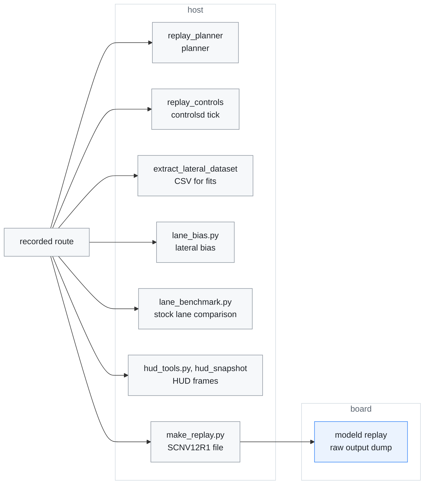
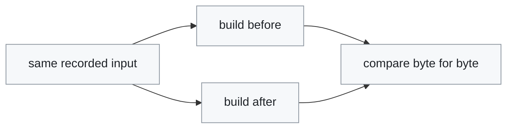
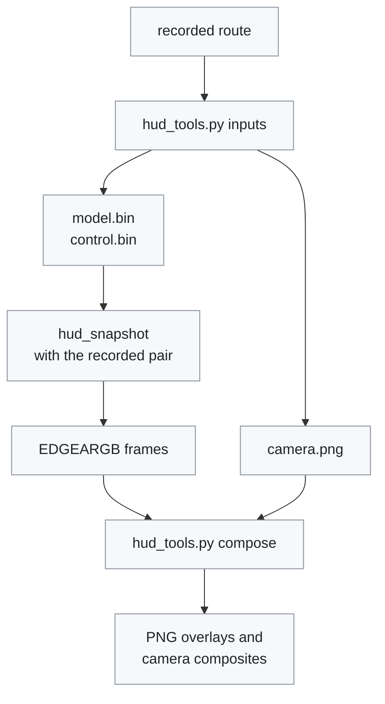
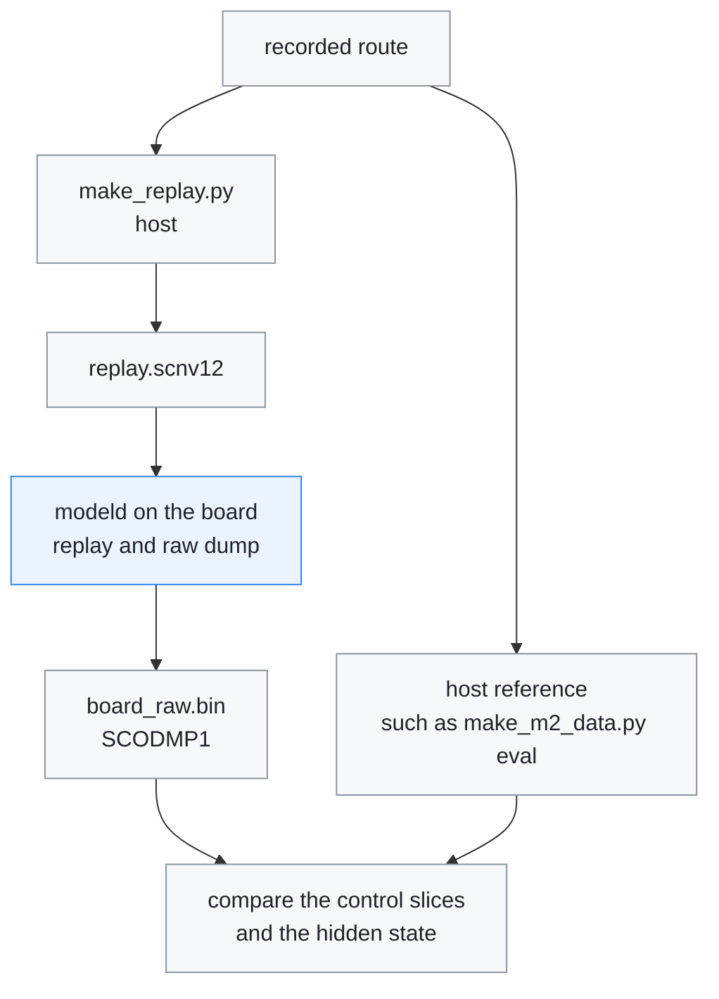

# Diagnostics

[← Documentation](README.md)

Procedures for the diagnostic tools, and the results they measured. Read it to
replay a recorded drive through one part of the runtime, to check that a
refactor left the output unchanged, or to verify a model swap on the board. The
tools themselves, their options and how to build them are in
[Diagnostic tools](../diagnostics/README.md).

Most procedures start from a `recordd` route. The host tools need only the
route; the model checks need the board's NPU:



## Lateral planner replay

`replay_planner` re-runs `LateralPlanner` over a recording and writes what the
planner asked for, one row per `ModelState`. The MPC has no board-specific
dependency, so a recorded route can be re-planned without the board:

```sh
cmake --build build-host --target replay_planner -j2
./build-host/bin/replay_planner out.csv <route>/events/*.bin
```

Columns include the recorded and re-planned desired curvature, the MPC's own
`target_curv`/`heading0`, the lane observations behind the plan, and the
`laneless`/`mpc_valid` flags. The options, which go before the output file, are
listed in [Diagnostic tools](../diagnostics/README.md#host). `--laneless` and
`--lane` re-plan the same route both ways without editing
`params/steering.json`, and lane changes run only with `--vehicle`.

For a planner refactor, run the route with `--exact` through the builds before
and after it. Two builds that plan identically give byte-identical files:

```sh
R=<route>; ./build-host/bin/replay_planner --exact --vehicle --lane \
  --steering $R/params/steering.json out.csv $R/events/*.bin
```

## Control tick replay

`replay_controls` runs a recording through `ControlsTick`, the logic of one
controlsd tick, at 10 ms ticks. The recorded CAN, `ModelState`, `PandaState`
and `Localization` records go in, the planner is computed in place and the
clock is the tick time, so identical code gives a bit-identical `--dump` and
digest. The dump has a line per tick: the state, the torque and curvature, the
HUD flags, the wheel angle, the driver torque, the tick time and the frames
sent. It also reports how often engaged, active and desire agree with the
recorded `ControlState`. A route engaged before recording started needs
`--force-engaged`.

```sh
R=<route>; ./build-host/bin/replay_controls --steering $R/params/steering.json \
  --cruise $R/params/adaptive_cruise.json --dump out.txt $R/events/*.bin
```

## Refactor checks

Three tools give byte-identical output from two builds whose behaviour did not
change, so a refactor is checked by running the same input through the build
before and after it and comparing the files:



| Tool | Output compared | Used for |
| --- | --- | --- |
| `replay_planner --exact` | every `LateralTarget` field as `%a` hex floats | planner refactors |
| `replay_controls --dump` | the dump and the digest | controlsd refactors |
| `hud_snapshot` | the `EDGEARGB` frames, within one compiler | HUD refactors ([HUD snapshots](#hud-snapshots)) |

## Lateral bias

If the car holds one side of the lane, `tools/model/lane_bias.py` says whether
the camera calibration is responsible:

```sh
python tools/model/lane_bias.py <route_dir> [<route_dir> ...]
```

It reads the recorded `modelState` and `controlState`, keeps straight engaged
stretches, and fits the perceived lane-centre offset against distance:

| Term | Meaning |
| --- | --- |
| translation (m) | the camera off the vehicle centreline, or the car really off-centre. **Camera intrinsics cannot produce this**: a principal-point or focal-length error acts about the camera, so its lateral effect is exactly zero at `x=0`. |
| rotation (rad/m) | the calibration-shaped term. A wrong `cx` of `dcx` pixels appears here as roughly `dcx/fx`. |

It also prints the tuning that was active on that drive from the route's own
`params/` snapshot, the mean steering angle needed to hold a straight line, and
the mean curvature command, so a control bias can be told apart from a
perception bias.

Straightness is judged from the model's own 48 m path, never from the steering
angle. When the car needs a non-zero angle to go straight, an `|angle| < k`
filter keeps one side of the curve distribution and manufactures a rotation
term that is not there. On the 2026-08-19 route that mistake reported
-4.22 mrad where the honest figure is -0.74 mrad.

## Stock lane comparison

The K7's stock camera keeps reporting its own lane lines in `LKA14` while
edgepilot drives. `tools/model/lane_benchmark.py` uses them as a second,
independent detector:

```sh
python tools/model/lane_benchmark.py <route_dir> [<route_dir> ...] --out DIR
```

It compares frames where both see the lanes clearly (stock quality 3, model
lane probability above 0.7, above 30 km/h). It leaves out 2 s around lane
changes, blinkers and the moments the car is on or crossing a line.

| Column | Meaning |
| --- | --- |
| `c0 rms L/R` | position difference at 1.5 m, per side |
| `corr L/R` | correlation of the in-lane wander with the means removed |
| `centre` | stock minus model lane centre; negative means the stock camera puts the car further right |
| `width` | stock minus model lane width (median) |
| `c1 str` | heading difference on straights (above 50 km/h, under 3° steering, under 0.6°/s yaw rate) |

The scenes are drawn on the video frames: model lanes solid orange, stock
lanes dashed blue. The stock line is its 1.5 m position and heading extended
straight, so it drifts on curves.

Results on the six drives of 2026-10-10 to 10-15, 121 minutes compared:
- position RMS 7–15 cm, wander correlation 0.80–0.90, 0.64 on the 10-15 night
  drive;
- lane-centre difference −7 to −9 cm on the pose-calibration drives and −2 to
  −4 cm after the switch to flow calibration;
- in 15 scenes where the two disagreed by more than 25 cm, the model's line
  was on the paint in 10 and the stock camera's in 3;
- road text, overpass shadows and lane widening pulled the stock line inward.

Measured on the two logged drives (no lane-line offset was applied on either):

| Drive | `path_offset_m` | Translation | Rotation |
| --- | ---: | ---: | ---: |
| 2026-08-16 | 0.00 | +19.9 cm | +0.18 mrad |
| 2026-08-19 | 0.07 | +7.2 cm | -0.74 mrad |

The rotation term is under 1 mrad on both, so the left-hugging on those drives
was a lateral offset, not a camera-matrix error.

## Lateral dataset extraction

`extract_lateral_dataset` replays a recording and writes one CSV row per
`ControlState` record (about 62 Hz). It joins the CAN state decoded by the
runtime's own `vehicle_can`, so signs and scaling match the board exactly:

```sh
cmake --build build-host --target extract_lateral_dataset -j2
./build-host/bin/extract_lateral_dataset out.csv <route>/events/*.bin
```

Version 2 route-level `events.bin` files work as well. A file truncated by the
tmpfs fill stops at the zero-filled gap, with the byte offset on stderr.

The columns are:

- time, wheel speed, `active`/`desire`/`block`, steering angle;
- driver and applied torque (`tq_norm` is sign-corrected and divided by
  `steer_max`);
- ESP12 lateral and longitudinal acceleration and yaw rate;
- the live bank estimate and its roll equivalent;
- requested and measured curvature;
- the NNFF-style future values `la_p03..p15` / `roll_p03..p15`, taken from the
  recorded model plan.

Two deviations from the runtime are deliberate:

- The bank filter runs at row rate with a `dt`-derived alpha, rather than the
  controller's fixed 100 Hz step.
- Future lateral acceleration is `v * dpsi/dt` off the plan's yaw angles,
  because the recorded `ModelState` has no plan acceleration.

Both were checked against known results. Straight-line bank reproduces -0.178
on the 2026-08-28 route (logged: -0.176), and the total-least-squares torque
fit over the 2026-08-19 route returns `latAccelFactor` 4.00, the value that
route was fit to.

## HUD snapshots

`hud_snapshot` runs the HUD renderer off-line, either on synthetic scenes or on
a recorded moment, and `tools/ui/hud_tools.py` prepares its input and turns its
frames into pictures:



Without input, `hud_snapshot` draws 27 scenarios at the HUD's 640x480 landscape
size: driving, alerts, cards, warnings and the less common branches (soft
disable, panda fault, radar-only lead, bar TPMS, engaged but blocked, ...). It
writes each frame as an `EDGEARGB` file and prints the draw timings:

```sh
./hud_snapshot --out /tmp/hud
```

- **Portrait.** To check the board's drawing path, draw with `--portrait`
  ([Diagnostic tools](../diagnostics/README.md#host)).
- **Builds.** The renderer needs no OpenCV, so the tool builds on the host as
  well as in the container build with `-DEDGEPILOT_BUILD_DIAGNOSTICS=ON`. Time
  it on the board, where the numbers matter (the host is 20-40x faster).
- **Refactors.** Frames from two builds of the same compiler are byte-identical
  when the drawing did not change, which is the check used for HUD refactors.
  Compare the host and the container build separately: GCC fuses multiply-adds
  that clang leaves apart.

To draw a recorded moment instead of the synthetic scenes:

1. `python3 tools/ui/hud_tools.py inputs <route_dir> <out_dir>` extracts a
   `ModelState` / `ControlState` pair (the current v13 layout; older records
   are zero-filled), plus the matching camera frame when the route copy has its
   `segments/`.
2. `hud_snapshot --model model.bin --control control.bin --out /tmp/hud` draws
   that pair.
3. `python3 tools/ui/hud_tools.py compose /tmp/hud [camera.png]` turns the
   frames into PNGs and composites them over the centre 4:3 of the camera
   frame, as the screen shows it.

### Alert sounds

To hear a sound change on the host, write every alert sound `overlayd` plays
to WAV files (`/tmp/alert_engage.wav`, ...) with
`alert_sound_preview --out /tmp/alert`
([Diagnostic tools](../diagnostics/README.md#host)). On the board,
`pkill -USR1 -f "[.]/overlayd"` plays them one by one through the speaker.

## Model on the board

The model checks need the NPU, so they run `modeld` on the board.

### NV12 replay

`modeld` can run headless from a recorded route. Replay mode reads an
`SCNV12R1` file instead of the camera ring and feeds the same GDC warp as live
capture, so it validates model execution and online calibration from stored
segments.

```sh
# host: cut 120 frames of a route into an SCNV12R1 replay
python3 tools/model/make_replay.py --route recordings/<route> --out /tmp/replay_nv12 --frames 120
scp /tmp/replay_nv12/replay.scnv12 root@<board-ip>:/root/edgepilot/

# board (stop the manager first, or at least modeld)
cd /root/edgepilot
EDGEPILOT_REPLAY_NV12=/root/edgepilot/replay.scnv12 \
  ./modeld models/supercombo.axmodel
```

### Model swap verification

A model swap changes three things at once: the warp input, the temporal
plumbing, and the network. The board side is verified by running a replay with
the raw outputs dumped, and comparing them with a host reference:



```sh
# board: same frames through the runtime, dumping raw outputs
EDGEPILOT_REPLAY_NV12=/root/verify/replay.scnv12 \
EDGEPILOT_RAW_DUMP=/root/verify/board_raw.bin \
EDGEPILOT_CALIB_AUTO=0 \
  ./modeld models/<candidate>.axmodel
```

`board_raw.bin` is an `SCODMP1` file of 2576-float frames.

- **Slices.** Compare it against the host reference on the slices that drive
  control (plan lateral offset, lane positions) rather than on the raw vector.
- **Hidden state.** Check that the hidden-state slice evolves smoothly: a dead
  temporal buffer still produces plausible single-frame output.
- **Calibration.** With `EDGEPILOT_CALIB_AUTO=0`, the host reference must use
  the rpy the board restored from `params/calibration.json`, because the
  calibration service feeds the input warp on every frame.

For the master core, `tools/model/axmodel/make_m2_data.py eval` builds the fp32
reference with the runtime's queue semantics from a MaixCAM2 recording, and
`tools/model/axmodel/run_axmodel_assembled.py` runs an axmodel on the same
inputs on the board. A host runner that takes an `SCNV12R1` replay is not in
the repository yet.

Measured when the master axmodel was brought up (200-frame replay): the board
output against the host axengine runner gave a plan lateral difference of
0.0008 m at 2 s, and a hidden-state cosine similarity of 0.9994.

## Related

- [Diagnostic tools](../diagnostics/README.md): every tool, its options and how
  to build it
- [Host tests](../tests/README.md): the unit tests and Python checks
- [Closed-loop replay](closed-loop-replay.md): replaying a drive with the car's
  response simulated
- [Rehearsal](rehearsal.md): replaying a recorded drive through the whole
  runtime on the board
- [Recording](recording.md): the route layout the tools read
- [HUD](hud.md): what the renderer that `hud_snapshot` runs draws, and the
  alert sounds
- [Model pipeline](model-pipeline.md): the warp and the NPU that the NV12 replay
  exercises
- [axmodel pipeline](../tools/model/axmodel/README.md): building the model a
  swap verifies
- [Runtime options](runtime-options.md): `EDGEPILOT_REPLAY_NV12`,
  `EDGEPILOT_RAW_DUMP` and the other switches
- [Departure alerts](departure-alerts.md): which events sound the alerts that
  `alert_sound_preview` writes
- [K7 Panda port](k7-panda-port.md): the K7 CAN signals that the replays decode
  with `vehicle_can`
