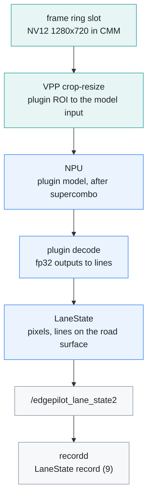

# Lane-line plugin

[← Documentation](README.md)

modeld can run an optional lane-line model after supercombo, through a plugin
that lives outside this repository. This document describes the slot: what
modeld does with a plugin, what a plugin provides, where its files go on the
board and what modeld publishes. Without a plugin, modeld runs exactly as it
does without this slot.

This diagram shows one camera frame through the slot:



## The split

The plugin only computes. modeld owns every hardware call, so a plugin needs
no AX SDK and cannot leave the NPU or the IVPS queues in a bad state.

| Part | Where | Does |
| --- | --- | --- |
| C ABI | `src/model/lane_plugin_abi.h` | the table a plugin exports, the result types, the lane vocabulary |
| Loader | `src/model/lane_plugin.cc` | `dlopen`, ABI check, result check, crash guard |
| Runner | `src/model/lane_runner.cc` | NPU session for the plugin's model, VPP input, decode call |
| Result | `src/model/lane_state_fill.cc` | `LaneState`: quarter-pixel points, every line projected on supercombo's road surface |
| VPP | `platform/maixcam2/maix_vpp.cc` | NV12 crop-resize into a physical buffer, one call at a time |
| Plugin | outside this repository | the model file and the decode of its outputs |

## 1. Loading

modeld looks for the plugin once, when it starts.

1. **Path.** `EDGEPILOT_LANE_PLUGIN` names the plugin's shared library. Unset,
   it is `/root/edgepilot-private/lane/liblane_plugin.so`. `0` turns the slot
   off. A missing file is not an error: modeld logs `lane plugin off (no …)`
   and runs without it.
2. **Crash guard.** Before it opens the plugin, modeld adds one to a counter in
   `$EDGEPILOT_LOG_DIR/lane_plugin_starts` (`/run/edgepilot`, a tmpfs). It
   clears the counter after 200 good frames or on a clean exit. If modeld dies
   twice inside a plugin, the counter stays at 2 and later starts skip the
   plugin until the board reboots.
3. **Table.** `dlopen` with `RTLD_NOW`. The plugin exports
   `edgepilot_lane_plugin_v1`, which returns the table below.
4. **Model.** modeld opens the model file next to the plugin as a second NPU
   session in the same process. The input must be a single NV12 `u8` tensor,
   `1 x (H*3/2) x W x 1` with an even `W` and `H`. Every output must be fp32.

A plugin that fails any check is logged with the reason and left off.

| Field | Meaning |
| --- | --- |
| `abi_version` | `EP_LANE_PLUGIN_ABI_VERSION`, now 1 |
| `name` | logged, and copied into `LaneState.plugin_name` (31 characters) |
| `model_file` | the model's file name in the plugin's directory |
| `roi` | the part of the camera frame the model sees, `[left, top, right, bottom]` as fractions |
| `decode` | turns the output tensors into lane lines, road boundaries and the vanishing point; returns 0 on success |

## 2. Each frame

The stage runs on modeld's main thread, after `ModelState` is published, so it
never delays the plan.

1. **Budget.** If more than 25 ms have passed since the frame arrived, the
   stage skips the frame, so the next supercombo frame is not pushed back.
2. **Input.** VPP crops the plugin's ROI out of the ring slot and resizes it
   with bilinear scaling straight into the model's input tensor. The CPU
   never touches the pixels. The ROI is rounded to even pixels for NV12. The
   flow worker's VPP pyramid and this call share one lock, because they use
   the same IVPS queue.
3. **Slot check.** If the camera overwrote the slot during the VPP read, the
   frame is dropped.
4. **NPU.** The NPU runs on the same thread as supercombo, one after the
   other. Two NPU user processes beside the camera's AI-ISP corrupt each
   other's outputs, so the plugin model must run inside modeld.
5. **Decode.** The plugin turns the outputs into lines. modeld then checks the
   result: counts, enum ranges, finite pixels. Confidences are clipped to
   0..1. A broken result is dropped.
6. **Publish.** modeld publishes a `LaneState`. A failed frame is published
   with `valid = 0`. After 100 failures in a row the stage turns itself off.

modeld also logs one line every 10 s:

```text
modeld: lane plugin runs=… failed=… skipped=… ms p50 … p95 …
```

Measured on 2026-10-15 for a 640x320 model input, per frame:

| Step | Cost |
| --- | --- |
| VPP crop-resize, 1280x288 to 640x320 | about 1.1 ms of hardware (up to about 7 ms when the camera pipeline holds the VPP) |
| NPU (one core) | about 7 ms |
| CPU | about 2 ms, almost all in the plugin's decode |

## 3. LaneState

The topic `/edgepilot_lane_state2` carries one `LaneState` per frame that the
stage ran on (`src/common/ipc_messages.h`, 6776 B). The number in the name goes
up with the layout, so a `modeld` from another build publishes on another
channel instead of being read with the wrong layout. recordd writes it as
record type 9 ([Recording](recording.md)), and
`tools/model/recording_reader.py` reads it with `read_route_lane_state`.

| Field | Meaning |
| --- | --- |
| `frame_id`, `capture_timestamp_ns` | the camera frame, the same as `ModelState` |
| `lane_timestamp_ns`, `execution_ms` | when the result was ready; VPP, NPU and decode time |
| `valid` | 1 when the frame was decoded |
| `road[10]`, `road_count` | every line, then every boundary, on the road: see below |
| `lines[6]` | slot, shape (solid, dashed, Botts' dots), double, colour, confidence, points |
| `boundaries[4]` | slot, type (wall, guardrail, curb, separator, cones, …), confidence, points |
| points | camera-frame pixels × 4 as `int16`, nearest first: centre `x4`, `y4`, paint `width4`, inner edge `edge_x4` |
| `vanishing_*` | the vanishing point in pixels and its confidence |
| `plugin_name` | the plugin's `name` |

The road block sits right after the header, so a reader that needs only the
road lines can take the first 848 bytes. Each `LaneRoadLine` holds:

- **What it is.** `kind` (line or boundary), its index, slot, type or shape,
  double, colour and confidence.
- **Where.** `y[17]`, the lateral position in metres to the right at the first
  17 points of the model's distance grid (X_IDXS, 0 to 48 m). A line gives its
  inner edge, the painted edge facing the lane; a boundary gives its points.
- **Coverage.** `first` and `last` are the grid points the measurement covers.
  When the nearest measured point is within 8 m, the points nearer than
  `first`, down to 0 m, come from a quadratic fitted to the points up to
  20 m, with its curvature limited to 0.02. Everything else is NaN, including
  gaps of more than 8 m between points.

The points go onto the road surface that supercombo predicted for the same
frame, not onto a flat road:

1. **Height.** Each line takes the height `z(x)` of the matching supercombo
   line: the ego lines take `lanes[1]` and `lanes[2]`, the outer lines
   `lanes[0]` and `lanes[3]`, the boundaries the road edges. An unusable height
   falls back to the mean of the two ego lines, then to a flat road at the
   camera height.
2. **Ray.** A pixel's ray meets that surface where its height first equals
   `z(x)`; between the grid points both are straight, so this is solved
   exactly.
3. **Frame.** The ray uses the calibration this frame was warped with, the
   camera height and the virtual camera offset, so the result is in the same
   frame as `ModelState`'s lanes.

Projecting onto supercombo's surface matters when the calibration and the road
disagree: on 2026-10-15, six rehearsed drives with an old calibration put the
LD inner edges 13.6 cm from supercombo's lines at 10 m on a flat road, and
4.5 cm on the surface. supercombo's lane lines lie close to the inner edges
rather than to the paint centre.

## 4. Shipping without the plugin

The plugin and its model are not in this repository. They do not ship with it.

- **Repository.** `.gitignore` ignores every `*.axmodel` except
  `models/supercombo.axmodel`, so a plugin model cannot be added by accident.
  GitHub's tag archives contain only tracked files.
- **Board.** The plugin's files go to `/root/edgepilot-private`.
  `scripts/upload_to_board.sh` copies only into `/root/edgepilot` and never
  touches that path.
- **Board image.** To give someone a board image without the plugin, delete
  `/root/edgepilot-private` first. modeld then logs `lane plugin off` and runs
  as before.

## Limits

- **Single frame.** Every result comes from one frame, with no tracking or
  smoothing.
- **Borrowed distance.** The road block's distances come from supercombo's road
  surface, so they are not an independent measurement. Only the lateral
  positions are LD's own.
- **Live loop only.** The stage runs in the live loop, which includes
  rehearsals. It does not run in `EDGEPILOT_REPLAY_NV12` replays.

## Related

- [Model pipeline](model-pipeline.md): the supercombo path the stage follows
- [Runtime](runtime.md): the processes, topics and hardware engine load
- [Runtime options](runtime-options.md): `EDGEPILOT_LANE_PLUGIN`
- [Recording](recording.md): the `LaneState` record
- [Rehearsal](rehearsal.md): running the stage on a recorded drive
