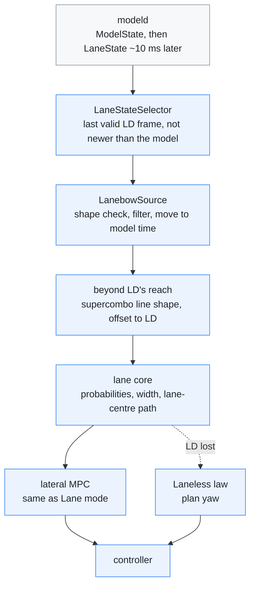

# Lanebow

[← Documentation](README.md)

Lanebow is the third path mode, beside Lane and Laneless. It is Lane mode with
its lane lines taken from the [lane-line plugin](lane-line-plugin.md) (LD)
instead of supercombo: while LD sees the lane lines the car keeps to their
centre, and when it does not, the car follows the model path as in Laneless
mode. Without a plugin, Lanebow is Laneless. The HUD paints the path as a
rainbow while LD steers.

This diagram shows one model frame in Lanebow mode:

## Why

On 2026-10-15 six board-rehearsed drives compared the two detectors frame by
frame (10,887 frames above 30 km/h):

| | LD | supercombo |
| --- | --- | --- |
| Frame-to-frame jitter at 10 m | 1.7 cm | 2.7 cm |
| Distance from the stock camera's lines (LKA14) at 1.5 m | 5.2 cm | 8.4 cm |
| Correlation with the stock camera | 0.86 | 0.76 |
| Frames where only this one sees a line | 4.3 % | 1.0 % |

Where the two agreed on the road surface, the LD inner edges lay within 4.5 cm
of supercombo's lines at 10 m. Where they disagreed, the stock camera sided with
LD.

## How

### The setting

`path_mode` in `steering.json` picks the mode: 0 Lane, 1 Laneless, 2 Lanebow
([Parameters](../params/README.md#path-mode)). The loader accepts only these
three values. An older file with `laneless_mode` is read as 0 or 1, and the web
console renames the key when it next writes the file. The web console shows the
setting as three buttons on the Steering tab.

### Picking the LD frame

modeld publishes a frame's `LaneState` about 10 ms after its `ModelState`, so
controlsd plans without waiting. `LaneStateSelector` keeps the last valid
`LaneState` and gives it to the planner when it is not newer than the model
frame and at most 120 ms older. That is usually the previous frame. One is
enough because every caller receives a frame's `LaneState` after its
`ModelState`: modeld publishes them in that order, controlsd reads the lane
topic first in each tick, and the replay tools go in recording order.

### The LD lane source

`LanebowSource` turns the LD ego lines into the lane core's measurement:

1. **Shape check.** For each new LD frame, each ego line must be on its own
   side of the car at 0 m and at most 3.6 m from it, or that line is dropped.
   A line further out belongs to the next lane: with one line in view, LD
   sometimes names it the ego line, and taking it would shift the lane by a
   whole lane. When both lines pass, they must be at least 2 m apart and must
   not cross within 20 m, or both are dropped. This drops straddled lines,
   swapped slots and stop lines taken for lane lines. Where LD reports two
   lines for one slot, the more confident one is used, as on the HUD and the
   BEV.
2. **Filter.** Each line goes through its own
   [lane-line filter](lane-line-filter.md), keyed on the LD frame's capture
   time and updated only when a new LD frame arrives.
3. **Move.** The filtered line is moved to the model frame's capture time by
   the car's own motion (the filter's `predict`), so a frame-old LD result
   lines up with the model frame. Moving shortens the line by the distance
   driven; `predict` extends its last segment by that much, so the reach does
   not jump by a grid point between a same-frame and a frame-old result.
4. **Extend.** The LD road block ends at 48 m, and LD often sees less (on the
   2026-10-16 rehearsals the shorter ego line fell short of 30 m in 12 % of
   frames); the MPC looks 2.5 s ahead, about 69 m at 100 km/h. Beyond LD's
   reach both lines follow one shared shape:
   supercombo's two lines, mixed by their probabilities, as far as the surer of
   them goes, and the plan for the rest. Each line keeps its own offset, the
   mean difference over the last 10 m of LD's reach, faded in over the same
   10 m, so beyond the reach the lane keeps the width LD measured there. With
   a shape per side, the far lines spread apart or crossed and the lane core's
   width check (out to 3 s ahead) cut the probability of lines LD saw well
   (see [Evidence](#evidence)).
5. **Probability.** A line's probability is 0 to 1 by its confidence (0.15 to
   0.4) times 0 to 1 by its reach (10 to 20 m). A normal line has 1, so one
   line alone keeps the planner on lines. When a line drops out, its
   probability holds for 0.12 s on the LD clock (two LD frames, also when LD
   runs a frame late), then the lane core's rate limit lowers it in 0.5 s
   while the moved line stays in place. After 1 s without it, its place is the
   other line moved by 3.5 m (probability 0, so the path does not use it), so
   the width check does not see a stray supercombo line.

The lane core then works as in Lane mode: the width check, the probability
rate limit, the lane-width filter (learned at 6.75 m, where LD always
measures), the path offset, the blend with the plan, the MPC, and the handover
to the Laneless law below an effective probability of 0.3. Lane changes and
blinker turns fade the probabilities as in Lane mode.

Both lane sources run every frame in every mode, so switching modes while
driving starts from warm filters.

### Display

- **HUD.** While LD steers, the path is a rainbow from red near the car to
  violet far ahead. It is the model path's ribbon (same width and length, down
  to the bottom of the screen) moved sideways onto the LD lane centre, so a
  switch to the model path changes only its colour and place. During a lane
  change, or with one LD line, it stays on the model path. The LD lines are
  drawn thin in their painted colour and pattern (solid, dashed, Botts' dots;
  a double line as one line). Like the other path colours, the rainbow turns
  amber as the steering output nears its limit. The lane-position ruler
  measures against the LD ego lines when both have a confidence of at least
  0.4. A frame LD could not decode keeps the last good result on screen for up
  to 0.3 s. The mode chip reads `LANEBOW` with a violet dot, `LANELESS` while
  it hands over to the model path, and `NO LD` when there is no LD result
  ([HUD](hud.md#road-scene)).
- **Web console.** In Lanebow mode the BEV tab draws the LD lines and
  boundaries (`LD lanes` layer) instead of supercombo's lines and edges, the
  same rainbow path while LD steers (tinted where the plan slows down, like
  the normal path), and the LD lane width in the `LANE W` chip. It keeps the
  last good LD result while it is within 0.15 s of the model frame
  ([Runtime options](runtime-options.md)).
- **Telemetry.** `ControlState.hud_flags` bit 10 is set in Lanebow mode, and
  `ControlState.lane_state_frame` holds the frame of the LD result the plan
  used.

## Evidence

On 2026-10-16 the build after the code review ran 18 recorded clips as board
rehearsals (two segments each, 32.7 minutes above 30 km/h): day and night,
highways and city streets, one roadworks clip and one wet road. Each
recording was then planned again in both modes with `replay_planner`, and the
board's own controlsd output in Lanebow was read from the rehearsal
recording. Above 30 km/h, weighted by frames:

| Measure | Lane | Lanebow |
| --- | --- | --- |
| Time on the model path | 9.0 % | 4.5 % (board: 4.4 %) |
| Switches between the lines and the model path | 5.8 a minute | 3.1 a minute (board: 3.0) |
| Lane centre at 0 m against the stock camera's (LKA14), median offset | 6.8 cm | 3.1 cm |
| Spread of that offset | 2.8 cm | 2.9 cm |
| Desired curvature change per frame | 0.77e-4 /m | 0.73e-4 /m |

- **Model path.** Lanebow spent less or the same time on the model path on 16
  of the 18 clips, and above 75 km/h 0.5 % instead of 4.4 %. The two
  exceptions, both on 2026-10-10, were within about a percentage point. What
  is left: roadworks (37 %; LD saw both lines in 59 % of its frames), slow
  city driving, lane changes and exits where the lane widens.
- **Detection.** LD saw both ego lines in 95 % of the frames above 30 km/h,
  one in 3.6 % and none in 1.4 %. Against the stock camera at 1.5 m its lines
  have a smaller bias than supercombo's (5.0 against 6.8 cm) and a similar
  spread (4.4 against 4.1 cm) and correlation (0.78 against 0.79), so the
  gain is mostly the bias. The earlier comparison in [Why](#why) found a
  higher correlation for LD; on these clips the two are the same.
- **Closed loop.** With the stretches around recorded lane changes left out
  (8 clips, 708 s), the lane-centring RMS in `replay_closed_loop` was 12.2 cm
  in Lanebow and 13.1 cm in Lane mode. Including them, four clips diverged in
  Lanebow. The replay feeds no blinker or steering torque, so the simulated
  car cannot start a lane change: while the recorded car changes lanes, it
  holds the old lane on LD lines of full probability. Once released far from
  the lane, it sees LD lines that keep the recorded car's names; whenever it
  is more than half a lane off, they fail the shape check and it swings. On
  the road LD names the lines from the car's own place, so this is a replay
  artefact.
- **Board.** The plugin took 8.4 ms (median) and 8.9 ms (95 %) per frame,
  with no failed frames in about 43,000. A controlsd tick took 264 µs on
  average; both lane planners run in every mode, so this is the same as in
  Lane mode. The plan used the LD frame one frame older than the model frame
  86 % of the time and the same frame 13 %.

## Limits

- **Closed-loop replay** cannot judge stretches around recorded lane changes,
  or where the recorded car is off the lane centre, as above.
- **Width check.** Lane mode checks the lane width out to about 90 m. With LD,
  the lines beyond LD's reach are borrowed from supercombo, so a lane split far
  ahead shows up only once LD sees it.
- **Distance.** The LD lines' distances come from supercombo's road surface
  ([Lane-line plugin](lane-line-plugin.md#3-lanestate)).
- **Diagonal markings.** LD reports painted lines as they are. Markings across
  a merge or a gore are lines to LD; the shape check drops only lines that
  cross the car or each other.
- **Not driven yet.** All of the above is from rehearsals and replays.

## Next

- A drive with Lanebow on, then the same measures from the recording.
- The LD line types are not used for control yet (for example, no lane change
  across a solid line).

## Related

- [Lane-line plugin](lane-line-plugin.md): where `LaneState` comes from
- [Lane-line filter](lane-line-filter.md): the filter and its `predict`
- [HUD](hud.md): the rainbow path and the LD lines on the LCD
- [Parameters](../params/README.md#path-mode): `path_mode`
- [Closed-loop replay](closed-loop-replay.md): the replay and its limits
- [Diagnostic tools](../diagnostics/README.md): `--lanebow` in the replay tools
