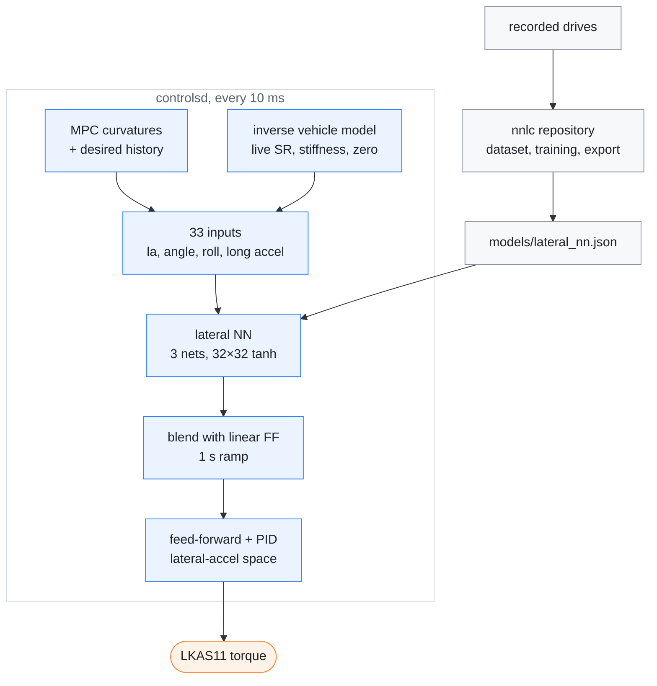

# Lateral NN

[← Documentation](README.md)

The lateral NN is an optional feed-forward for the torque controller. It is a
small neural network, trained on the K7's own recorded drives, that gives the
steering torque a target trajectory needs. With `nn_feedforward` on and
`models/lateral_nn.json` in place, it replaces the linear feed-forward while
the PID stays as it is.

This diagram shows where the model comes from and where it enters the
controller:

## Why

The torque controller ported from openpilot turns lateral acceleration into
torque with one learned factor, an offset and a friction term. sunnypilot's
Neural Network Lateral Control (NNLC) replaces that with a per-car model
trained on driving logs, but it has no model for the K7 or its relatives.
Training one from edgepilot's own recordings gives a model of this car's EPS,
tyres and tuning.

## How

### The model

The model is trained in the separate `nnlc` repository (its README has the
details). It is an inverse steering model: given the lateral-acceleration
trajectory around the moment the car responds, it gives the torque command
that produced it.

- **Target:** the torque sent at time t, as a fraction of `steer_max`, with
  right positive (the control sign).
- **Inputs:** 33 in all.
  - Speed at t.
  - Lateral acceleration, its jerk and road roll at the response time
    t + 0.3 s.
  - Lateral acceleration at −0.5…+1.5 s around the response time (13 points)
    and roll at −0.3…+1.5 s (7 points).
  - Steering angle at the response time and at −0.3…+1.5 s around it
    (7 points), and longitudinal acceleration.
- **Network:** three nets of 32×32 tanh, averaged, output clipped to ±1.
  Training mirrors every sample left to right, so the response is symmetric.
- **File:** format `edgepilot-lateral-nn` version 1. It holds the input names,
  the window definition, the normalisation, the weights and test vectors.
  `LateralNnModel::load_text` refuses a file when:
  - the names it rebuilds from the window definition differ from the file's;
  - an input would read outside the 1 s history or the plan;
  - a value is not finite as a float;
  - the output clip is outside ±1;
  - an activation is not `tanh` or `linear`;
  - or its own evaluation of the file's test vectors differs by more than
    2·10⁻⁴.

  The file also carries `input_tests`: a synthetic trajectory and the inputs
  the training code built from it. `gtest_lateral_nn` feeds the same
  trajectory to `LateralNnInputs` and expects the same 33 inputs, so a
  training change that keeps the names but changes what an input means fails
  there.

### Inputs at run time

Training uses the trajectory that happened; the controller feeds the target
trajectory in the same places (`LateralController::lateral_nn_feedforward`).

- **Lateral acceleration at δ s ahead:** the MPC curvature trajectory at
  δ + plan age, times v².
  - Each point is held to the same limits as the PID's request: the 80° hold
    curvature while the driver's hands are off (`hold_angle_bounds`), and
    ±3 m/s² (plus the learned roll) and the curvature limit
    (`limit_curvature`, shared with `clip_curvature`).
  - Without the hold, a hands-off turn tighter than 80° would feed the model
    angles far beyond its training and push the wheel toward the 85° fault
    angle.
  - Points in the past come from a 1 s history of the target at 100 Hz.
  - A non-finite plan point makes the model's output NaN, and that tick uses
    the linear feed-forward.
- **Jerk:** the central difference of that trajectory over ±0.05 s.
- **Steering angle at δ:** that curvature through the inverse vehicle model,
  with the live steer ratio, stiffness, angle zero and roll. At one speed it
  is linear in curvature, so `TorqueController::angle_map` gives its gain and
  offset once per tick. Training lateral acceleration was computed from the
  measured angle the same way.
- **Roll:** the road-bank estimate divided by g, the same estimator the
  dataset used; future roll is taken as now.
- **Speed and longitudinal acceleration:** the current values. Training took
  the speed at t as well, but the longitudinal acceleration at the response
  time.

### In the controller

`TorqueController::update` computes the linear feed-forward as before. Then it
blends in the model, converted to lateral-acceleration units by
`latAccelFactor`, by a weight from 0 to 1. The PID, its limits and the torque
limits are unchanged. The model's output already contains the
straight-driving bias, bank, friction and dynamics, so at weight 1 none of the
linear terms remain.

The weight ramps over 1 s toward 1 while all of these hold, and toward 0
otherwise:

- `nn_feedforward` is on and a model is loaded;
- the car is steering;
- the speed is above 3 m/s, the lowest speed in the training data.

Turning the switch on or off while driving, and every engagement, therefore
blends rather than steps. The PID integrator is not moved. On the board it
holds 0.01–0.05 m/s² on average, so a switch while steering leaves an offset
of about 0.01–0.03 m/s² that decays in 12–20 s.

While the model contributes, `ControlState.hud_flags` bit 12
(`kHudFlagNnFeedforward`) is set. In routes before 2026-10-09, bit 11 was the
brake lights. `LearnerState.flags` bit 16 (`kLearnerLateralNnLoaded`) says
whether controlsd loaded a model.

### Setting and file

| Item | Value |
| --- | --- |
| Switch | `nn_feedforward` in `steering.json`, off by default; Steering tab of the web console |
| Model file | `models/lateral_nn.json`, or `EDGEPILOT_LATERAL_NN_MODEL`; `upload_to_board.sh` sends it |
| Start-up log | `controlsd: lateral nn <path> (<name>, 33 inputs) nn_feedforward=<0/1>`, or `lateral nn off: <reason>` |
| Recording | recordd copies the model into each route as `models/lateral_nn.json` |
| Replay | `replay_controls` and `replay_closed_loop` take `--lateral-nn <route>/models/lateral_nn.json`; with the switch on and no model, they warn and run the linear feed-forward |

Without a model file, or with a file the loader refuses, the switch does
nothing and the linear feed-forward is used.

The web console greys out the linear terms (offset, bank, friction deadzone)
while the switch is on and controlsd reports a loaded model. It greys out the
switch itself when controlsd could not load one.

## Evidence

Offline, by route-level 5-fold cross-validation, the torque RMSE as a
fraction of `steer_max`:

- The data is 25 drives with usable samples (2026-09-25 to 10-15, 7.8 h
  usable).
- The routes are split by date into five folds of similar size, and every
  route is held out once.

| Model | RMSE | \|la\| ≥ 1 m/s² |
| --- | ---: | ---: |
| torqued-style linear (`a·la + b·roll + c·friction + d`) | 0.060 | 0.119 |
| sunnypilot's network shape (18 inputs) | 0.051 | 0.095 |
| this model, one net | 0.0423 | 0.081 |
| this model, the shipped three nets | **0.0414** | **0.078** |

The shipped model is 31 % better than the linear model, and 35 % better above
1 m/s².

Open-loop replays with `replay_controls --force-engaged` give the same
recorded inputs to both feed-forwards, without the car responding:

| Route | Model in use, of steering ticks | Tick-to-tick torque change, linear → NN | Mean distance from the recorded torque, linear → NN |
| --- | ---: | ---: | ---: |
| 2026-10-15--03-14-59-306 | 94.5 % | 2.09 → 1.87 | 22.4 → 13.0 |
| 2026-10-14--19-09-44-760 | 93.3 % | 2.10 → 1.96 | 20.1 → 13.0 |
| 2026-10-12--22-37-07-989 | 88.4 % | 2.14 → 1.97 | 16.1 → 12.0 |

- The steering ticks without the model are below 3 m/s and in the
  large-angle holds at intersections, where no torque is sent.
- The replay runs torqued without the board's saved state, so its offset
  stays 0 and the replay's linear feed-forward sits about 0.2 m/s² off the
  board's. On the board the model and the linear feed-forward differ by about
  0.05 m/s². The distance from the recorded torque is therefore mostly this
  artefact.

With the switch off, `replay_controls` gives the previous build's output.
Without a model the digests match bit for bit (10-15 and 10-12). With a model
loaded the control dumps match byte for byte. The digest then differs only
through the new `kLearnerLateralNnLoaded` flag in `LearnerState`.

On the board (Cortex-A53 at 1.2 GHz, beside the running runtime at a load of
about 6), a minute of the 10-15 drive was replayed with `--force-engaged`:

- A tick takes 130 µs of CPU time without a model, 135 µs with the switch
  off and 190 µs with it on, counting the reading of the recording.
- So the model costs about 55 µs a steering tick: about 40 µs for the three
  nets, the rest for building the inputs from the plan.
- A loaded model with the switch off costs about 5 µs a tick, for the input
  history and the hold limit.

Two choices keep the nets' share down:

- The weights are stored input-major, so the inner loop over the outputs is
  vectorised.
- tanh is computed as 1 − 2/(e²ˣ + 1), because glibc's `tanhf` takes about
  200 cycles a call on the A53.

Before these, the nets alone took 82 µs a tick.

## Limits

- **Offline only:**
  - The numbers measure how well the model explains the torque that was sent.
    The drives were closed-loop, so it can have learned some of the feedback.
  - Only a road comparison shows whether driving gets better.
- **Thin data at high lateral acceleration:** about 3 minutes above
  1.5 m/s². The mirror keeps the curves monotonic and symmetric there, but
  their accuracy is unchecked.
- **Lag:** the model's response time is 0.3 s, while lagd puts the controller's
  path delay near 0.55 s. The two are separate here: the PID compares against
  the delayed request as before, and the model reads the plan at its own
  offsets.
- **Future speed:** training's future lateral acceleration used the speed at
  each future point; the runtime uses the current speed. This matters only
  when braking hard into a curve (0.1 % of samples, output change up to 0.11).
- **Mirror zero:** the mirror flips angles about one zero fitted over all
  drives (−1.4°), while each drive's own zero is −1.0 to −1.9°. Fitting it per
  drive changed nothing measurable.
- **This car only:** the model encodes the K7's EPS and tyres and the
  controller of the drives. A change of steering hardware, tyres or the
  vehicle-model parameters calls for retraining.

## Next

- **Road comparison:** drive with the switch on and off on the same roads. The
  recording's `hud_flags` bit 12 tells the modes apart. Compare curvature
  tracking, torque smoothness and driver overrides.
- **More data:** engaged drives on ramps and winding roads, then retrain and
  replace `models/lateral_nn.json`.

## Related

- [Parameters](../params/README.md): `nn_feedforward` and the torque
  controller values
- [Diagnostics](diagnostics.md): `extract_lateral_dataset`, the CSV the
  training reads
- [Diagnostic tools](../diagnostics/README.md): `replay_controls` and its
  options
- [Model package](../models/README.md): the model files in the repository
- [Closed-loop replay](closed-loop-replay.md): replaying a drive with the
  car's response simulated
