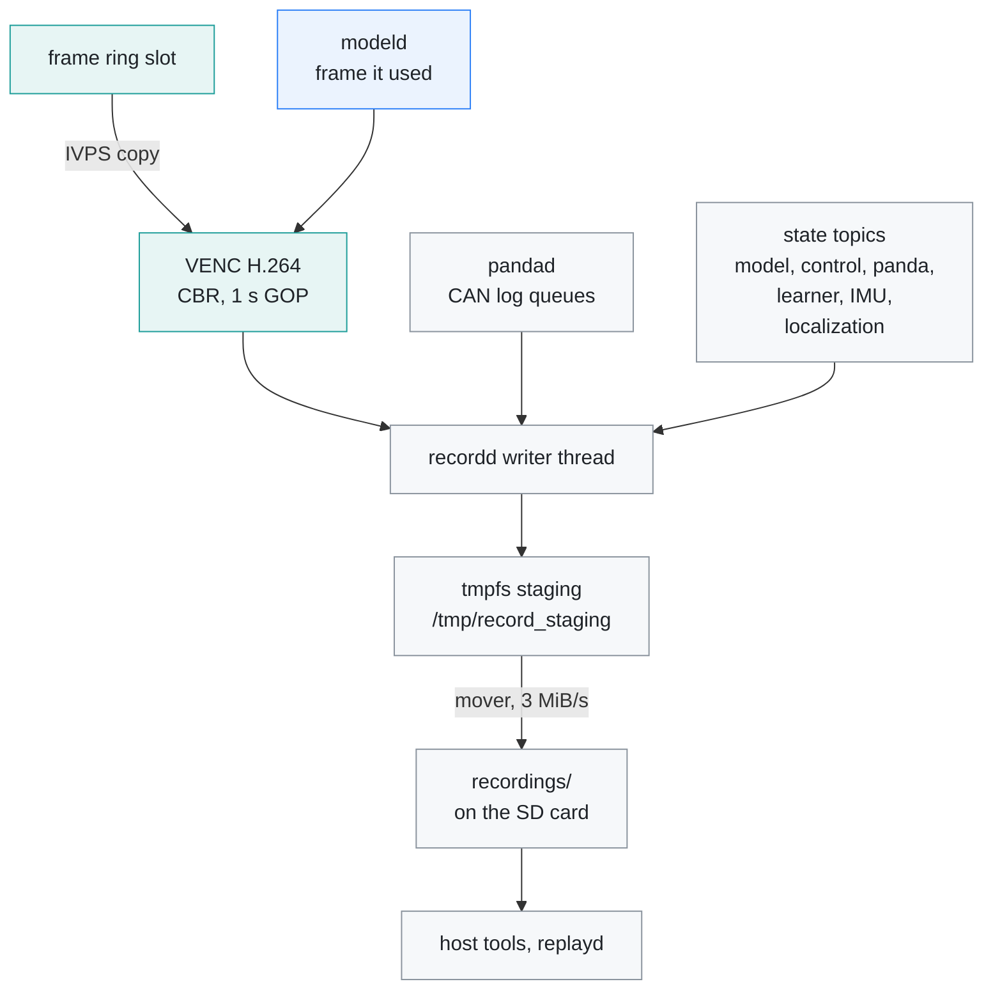
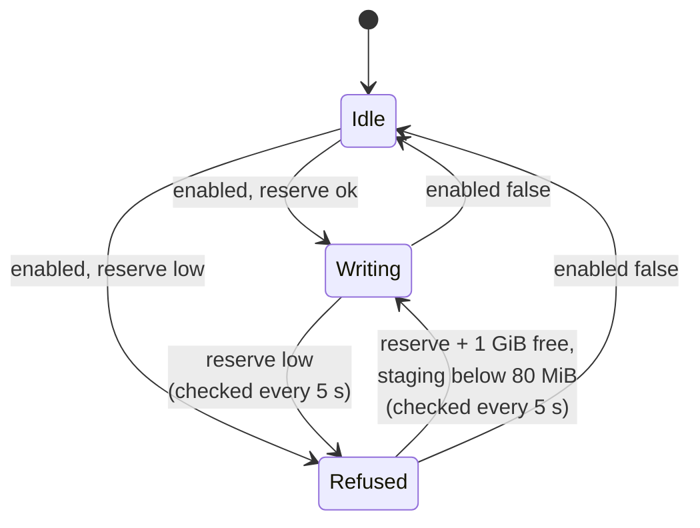
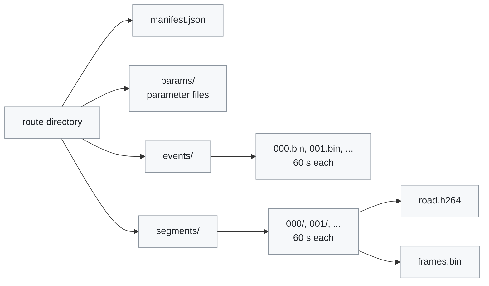

# Recording

[← Documentation](README.md)

`recordd` writes each drive as a route: the camera video as H.264 in one-minute
segments, an event log with every CAN batch and state snapshot, and a copy of
the parameter files. This document describes the route layout, the binary
format and its versions, for anyone who reads a route or changes what is
recorded.

`recordd` encodes the frame `modeld` used and logs the shared-memory states
beside it; the route is written to tmpfs first and moved to the SD card:

`recordd` writes the routes the host tools read (`recording_reader.py`, the
replay tools, `lane_bias.py`). `gtest_recording` covers
`src/recording/recording_writer.*`.

## Video

- `recordd` follows the frame `modeld` used (`/dev/shm/edgepilot_record_frame`),
  copies the ring slot into its own pool block with IVPS, checks the slot was
  not overwritten meanwhile, and encodes it with the hardware H.264 encoder
  (VENC, CBR, 1 s GOP). The CPU never touches pixels (~5% of a core while
  recording).
- H.264 because the board's decoder only decodes H.264, so a route can be
  replayed as recorded ([Rehearsal](rehearsal.md)).
- The video is 1280x720 at 20 fps. `bitrate_bps` in `params/recording.json`
  sets the bitrate (1-10 Mbit/s, 8 Mbit/s when it is missing); it is read
  once, when `recordd` starts. The top is what the tmpfs staging cap holds:
  a closed segment still being moved plus the one being written.

## Starting and stopping a route

`params/recording.json` `enabled` starts and stops a route. `recordd` looks at
the file every 250 ms and acts when it changes. A route needs a storage
reserve: at least 5 GiB and 10% of the SD card free, and at most 160 MiB
waiting in the tmpfs staging area. More than that means the card is not
keeping up (at 8 Mbit/s the staging peaks near 106 MiB while a closed segment
moves), and the board's `/tmp` (224 MB, no swap) would run out of memory.
After a staging stop, recording starts again only once the staging is below
80 MiB, as the SD reserve needs 1 GiB more than the stop level.

While `enabled` stays on, a refused or stopped route is not the end:
`recordd` checks the free space every 5 s and starts a new route once 1 GiB
more than the reserve is free. The margin keeps it from starting and stopping
in a loop, because the stopped route's files still move from tmpfs to the SD
card. Turning `enabled` off clears the storage warning.

`recordd` publishes `recordState` twice a second: whether a route is being
written, and what stopped it, if anything. `overlayd` shows a red `REC`, a
`STORAGE FULL` chip when the SD reserve is exhausted, or an `SD CARD SLOW` chip
when the staging cap stopped it while the card still has room
([HUD](hud.md)). A route stopped for space is closed as complete.

## Route layout

A route is a directory named after its start time in Korea Standard Time
(the board has no time-zone data), such as `2026-10-12--22-37-07-989`:

| Path | Holds |
| --- | --- |
| `manifest.json` | `version`, `complete`, `video_codec` (`"h264"`), `width`, `height`, `fps`, `bitrate`, `segment_seconds` (60), `video_frames`, `event_records` |
| `params/` | a copy of every `*.json` in the parameter directory when the route started |
| `events/NNN.bin` | the event log, one 60 s chunk per file |
| `segments/NNN/road.h264` | the H.264 stream of one segment, starting with its SPS and PPS so it decodes alone |
| `segments/NNN/frames.bin` | the frame index of that segment |

- The manifest is written with `"complete": false` when the route starts and
  rewritten when it closes.
- A new segment starts at the first keyframe at or after 60 s. With the 1 s
  GOP a segment is 60-61 s long, and usually 1220 frames (about 61 s), because
  1200 frames take just under 60 s.
- An event chunk ends at the first record 60 s after it began. Chunks and
  segments are cut independently.

### Staging and the mover

The active route is written to tmpfs (`/tmp/record_staging`,
`EDGEPILOT_RECORD_STAGING`), so SD card latency spikes cannot block the writer.
Each closed file is moved to `recordings/` in the install directory on the SD
card (`EDGEPILOT_RECORD_ROOT`); the rest of the route follows when it closes.

- The mover copies 1 MiB at a time, syncs each chunk, keeps to 3 MiB/s, and
  runs at idle IO priority. A plain copy piled up dirty pages and held the SD
  card for seconds when they were written: the board's load reached 10 and one
  SSH login took 36 s. A recording averages about 1.6 MB/s (8 Mbit/s video plus
  the CAN and state logs).
- A route left in staging by a session that died is moved to the SD card when
  `recordd` starts.
- Writes wait in a queue of up to 1024 entries; when it is full, a write is
  dropped and counted in `recordd`'s log line (`write_queue_drops`).

## Event log

The event log is written as 60 s chunks in `events/NNN.bin`. Each chunk starts
with a file header and holds records one after another, each a 16-byte header
and its payload. Timestamps are `CLOCK_BOOTTIME` nanoseconds, the runtime's
common clock.

File header (32 B):

| Field | Size | Value |
| --- | ---: | --- |
| `magic` | 8 B | `EDGELOG1` |
| `version` | 4 B | the recording version, now 13 |
| `header_size` | 4 B | 32 |
| `route_start_ns` | 8 B | when the route started |
| `reserved` | 8 B | 0 |

Record header (16 B):

| Field | Size | Value |
| --- | ---: | --- |
| `timestamp_ns` | 8 B | the snapshot's or CAN batch's own timestamp |
| `type` | 2 B | the record type below |
| `flags` | 2 B | 0 |
| `payload_size` | 4 B | bytes that follow |

### Record types

| Type | Record | Payload |
| ---: | --- | ---: |
| 1, 2 | `CanRx` / `CanTx` | variable CAN batch |
| 3 | `ModelState` | 3736 B |
| 4 | `ControlState` | 240 B |
| 5 | `PandaState` | 96 B |
| 6 | `LearnerState` | 128 B |
| 7 | `Imu` | 16 B + 40 B per sample (about 10 samples every 100 ms) |
| 8 | `Localization` | 128 B |

- State payloads are the structs of `src/common/ipc_messages.h` as they are.
- A CAN batch is an 8-byte header (`count`, `dropped`) and `count` frames of
  84 B (`src/recording/recorded_can.h`). `CanRx` comes from `pandad`'s receive
  log. `CanTx` holds the batches `controlsd` generated, as `pandad` took them,
  whether or not TX was enabled; in rehearsal `replayd` logs them instead.
- An `Imu` record holds only the samples of that batch, not the whole buffer.
- The IMU axes are the chip's and the gyro bias is not removed
  (`recording_reader.read_route_imu`).

## Frame index

Each segment's `frames.bin` maps the encoded frames to camera frames. Header
(48 B):

| Field | Size | Value |
| --- | ---: | --- |
| `magic` | 8 B | `EDGEIDX1` |
| `version` | 4 B | the recording version |
| `header_size` | 4 B | 48 |
| `record_size` | 4 B | 40 |
| `width`, `height`, `fps` | 3 × 4 B | 1280, 720, 20 |
| `segment_start_ns` | 8 B | capture time of the segment's first frame |
| `reserved` | 8 B | 0 |

Then one 40 B record per frame: `frame_id`, `capture_timestamp_ns`,
`encode_index`, `file_offset` and `packet_size` in `road.h264`, and `flags`
(1 for a keyframe).

## Versions

The version is `kRecordingVersion` in `src/recording/recording_format.h`. It
changes with any recorded layout; nearly every change was to `ModelState`.

| Version | Change | `ModelState` |
| ---: | --- | ---: |
| 1 | carried unused lateral draft fields | 4384 B |
| 2 | dropped the lateral draft fields; kept a single route-level `events.bin` | 4080 B |
| 3 | rotates event chunks `events/NNN.bin` alongside video segments; record layout as version 2 | 4080 B |
| 4 | dropped the stop-line block that openpilot v0.9.4 does not emit | 4048 B |
| 5 | dropped the plan position stds and orientations that nothing read; added `LearnerState` | 3256 B |
| 6 | added the plan yaw and yaw rate (`plan_yaw`, `plan_yaw_rate`) that laneless mode steers from | 3520 B |
| 7 | added the camera mount the warp used for that frame (`camera_offset_m`, `camera_height_m`) | 3528 B |
| 8 | added the model's pedal predictions (`gas_press_probs`, `brake_press_probs`) | 3576 B |
| 9 | only changed the two magics to `EDGELOG1` and `EDGEIDX1` | 3576 B |
| 10 | appended the flow calibrator's shadow state (`flow_calibration`) | 3632 B |
| 11 | grew `flow_calibration` by four fields, made its spread a standard deviation, added `calibration_source` | 3680 B |
| 12 | added `lead_flow`, the lead's expansion rate from the optical flow | 3712 B |
| 13 | added `lead_track`, the lead's fused distance and relative speed | 3736 B |

Notes on the changes:

- **Version 3.** Version 2's single `events.bin` filled the 988 MB tmpfs
  staging in about 30 minutes on long drives from CAN logging alone
  (~0.5 MB/s), and silently killed the rest of the recording. That is why
  version 3 rotates event chunks alongside video segments.
- **Version 5.** Readers that do not know the `LearnerState` record skip it.
- **Version 7.** With the mount in each frame, the HUD and the analysis tools
  use exactly what modeld applied.
- **Version 8.** The predictions are the chance the driver presses the pedal
  0, 2, …, 10 s ahead, which the departure alert reads
  ([Departure alerts](departure-alerts.md)).
- **Version 9.** Recordings up to version 8 carry the earlier magics
  (`K230LOG1`, `K230IDX1`), and every reader still accepts them.
- **Version 11.** The four new fields are `mount_changes`, `window_parallax`,
  `estimate_blocks` and `rejected_windows`. The spread became the standard
  deviation of the block medians (`sd_pitch`, `sd_yaw`; version 10 had a range
  there). `calibration_source` holds the warp calibration's source and the
  pose loop's own estimate. `calibration` is now the value the warp used, with
  the status, block count and spread of that source
  ([Flow calibration](flow-calibration.md)).
- **Versions 12 and 13.** See [Lead flow](lead-flow.md).

### Older recordings

The readers take every version from 2 on. `src/recording/recorded_model_state.h`
and `recording_reader.model_state_layout` skip the blocks that versions 2 to 4
still carried, and leave the fields added after a payload's version zeroed;
`recording_reader.flow_calibration`, `calibration_source`, `lead_flow` and
`lead_track` read those fields from any version. Only version 1 cannot be read:
no reader has its layout, and `recording_reader.py` rejects its payload size.

## Readers

- `tools/model/recording_reader.py` reads the v2 to v13 layouts. It checks each
  payload's size against the layout of its version, so a layout changed
  without a version bump fails instead of decoding garbage.
- `lane_bias.py`, `hud_tools.py`, `fit_lateral_params.py lag`, and
  `export_can_fixture.py` all walk the event log through its
  `iter_event_records`.
- In C++, `src/recording/event_log_reader.h` reads the event log for the
  diagnostic tools and `replayd`, and `recorded_model_state.h` turns any
  version's `ModelState` into the current struct.
- The C++ reader stops at a cut-off tail (a chunk that tmpfs filled with
  zeros, or the last chunk after a power loss) instead of trying to
  resynchronise. The Python reader stops only where a record runs past the end
  of the file: through a zero-filled tail it yields empty records of type 0,
  which match no record type.
- `check_recording_reader.py` holds the Python reader's layouts, record types
  and version to the C++ headers.

## Related

- [Runtime](runtime.md): `recordd` among the other processes, and the topics it
  reads
- [Rehearsal](rehearsal.md): replaying a route through the whole runtime with
  `replayd`
- [Diagnostics](diagnostics.md): the replay and HUD tools that read routes
- [Model tools](../tools/model/README.md): `recording_reader.py` and the other
  route readers
- [HUD](hud.md): the `REC` and `STORAGE FULL` indicators
- [Flow calibration](flow-calibration.md): the flow calibrator state in
  `ModelState`
- [Lead flow](lead-flow.md): the lead's expansion rate and lead track in
  `ModelState`
