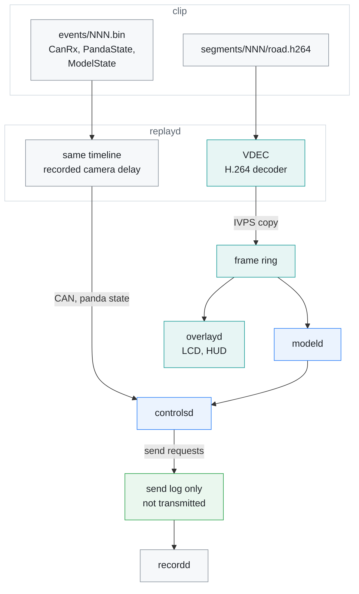
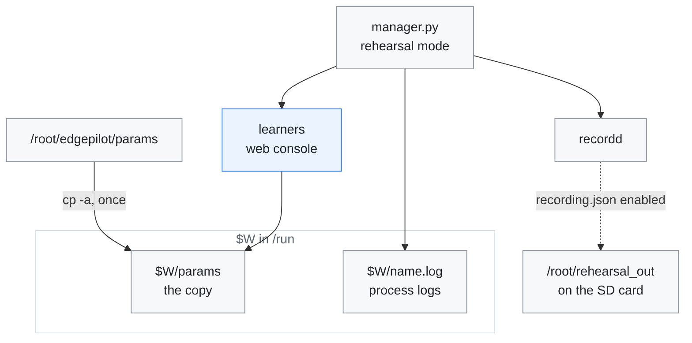

# Rehearsal

[← Documentation](README.md)

A rehearsal runs the whole MaixCAM2 runtime on a recorded drive at real time:
`replayd` takes the place of `camerad` and `pandad`, and `modeld`, `controlsd`,
`overlayd` and `recordd` run exactly as in the car. The LCD shows the recorded
road with the live HUD, alert sounds play, and the rehearsal can itself be
recorded and compared with the original.

How the recorded drive reaches the runtime in place of the camera and the
Panda:



## What `replayd` does

- **Video:** decodes `segments/NNN/road.h264` frame by frame on the AX630C
  hardware decoder (VDEC) at the recorded capture intervals and copies each
  frame into the CMM frame ring with IVPS, where the camera would put it. The
  CPU never touches pixels.
- **Frame timing as in the car:** each frame carries its recorded capture time,
  moved onto the replay timeline, and is published once its recorded camera
  delay has passed: the time from the sensor's timestamp to the frame ring,
  about 24 ms by day and 43 ms at night (longer exposure). `modeld` runs a
  frame as soon as it arrives, so the delay is the recorded `ModelState`'s
  `model_timestamp_ns` minus the capture time minus `model_execution_ms`; on
  the board that matched the ring time within 0.5 ms. `replayd` reads those
  records ahead of the frames. The plan age and the order of frames against CAN
  are then the car's: on a night clip on 2026-10-19 the rehearsal's delay was
  the recorded one plus 0.6 ms (p50, at most 1.8 ms, the loop's 1 ms step).
  Before that, `replayd` stamped a frame when it came out of the decoder, so
  plans looked 24-43 ms fresher than in the car. The decoder hands back the
  capture time it was given as the frame's PTS, exactly and in order (all 2328
  frames of that rehearsal).
- **CAN and panda state:** publishes the recorded `CanRx` batches and
  `PandaState` on the same timeline, into the queues `pandad` feeds (and the
  recorder's CAN log queue). It reads them as it goes, in recorded-time order
  (0.5 s reorder window), from the last event chunk that starts more than 2 s
  before the start, so its memory does not grow with the route.
- **Transmit:** `controlsd`'s send requests are **not transmitted**; they go to
  the send log only, so a rehearsal is always shadow.
- CAN and panda state are stamped when they are published. When the clip ends
  `replayd` idles so the manager does not restart it.

The manager starts `replayd` under the name `camerad` and leaves out `pandad`,
`imud` and `locationd`.

## 1. Copy `replayd` to the board

`upload_to_board.sh` does not upload `replayd`. Copy it from `build-ax630/bin`
into `/root/edgepilot` by hand, and again when it changes: the upload leaves the
old one in place.

`replayd` reads recording version 14 only, like the other readers; routes made
before 2026-10-19 were rewritten to it
([Recording](recording.md#rewritten-recordings)). An older binary finds no
frames in newer routes ([Troubleshooting](#troubleshooting)).

## 2. Cut a clip

Routes record H.264 (`road.h264`), which the hardware decoder replays as it is.
A clip is a directory with `segments/NNN/` and `events/NNN.bin` from one route:

- **Pick the event chunks by time, not by number.** Event chunks rotate every
  60 s, but a new video segment starts at the first keyframe at or after 60 s,
  so a segment is usually 1220 frames (about 61 s) and the two drift apart
  along a route ([Recording](recording.md#route-layout)). `replayd` only
  replays the CAN that falls inside the video's time. Take the chunks whose CAN
  times cover the clip's frames, usually the same number and the next two late
  in a route.
- **Keep it short anyway.** `replayd` no longer holds the CAN and panda records
  in memory (before 2026-10-19 it held about 34 MB per event chunk, so a clip
  had to fit in the 447 MB of RAM). Long clips still tied up the hardware
  decoder's memory: on 2026-10-15 a three-segment rehearsal ended in a VDEC
  allocation failure and a reboot. Two segments, with `drop_caches` and
  `compact_memory` before each run, have been safe.
- **Symlinks are enough.** A clip can link to the route on the SD card. The
  video is read at about 1 MB/s. A copy in tmpfs (`/tmp`) also costs RAM, about
  90 MB per segment with its chunk.

## 3. Run the rehearsal

Stop the service and start the manager in rehearsal mode, on a copy of the
parameters:

```sh
systemctl stop edgepilot
W=$(mktemp -d /run/edgepilot-rehearsal.XXXXXX)
cp -a /root/edgepilot/params $W/params && cp -a /root/edgepilot/params.defaults $W/params.defaults
EDGEPILOT_LOG_DIR=$W EDGEPILOT_PARAMS_DIR=$W/params \
EDGEPILOT_REPLAY_ROUTE=/root/rehearsal/<clip> EDGEPILOT_REPLAY_START=0 EDGEPILOT_REPLAY_DURATION=58 \
EDGEPILOT_FORCE_ENGAGED=1 EDGEPILOT_RECORD_ROOT=/root/rehearsal_out \
python3 /root/edgepilot/manager.py
```

Where a rehearsal writes, so the real parameters stay as they were:



- **The copy keeps the learners off the real parameters.** In a rehearsal they
  learn from the replayed drive as if it were driven again, and save it:
  - the pose and flow calibration in `modeld`, and `paramsd` in `controlsd`;
  - `torqued` too while lateral control is active, as with
    `EDGEPILOT_FORCE_ENGAGED=1`. Its points are wrong then, because the recorded
    car answered the original controller.
  - `lagd` runs in `locationd`, which a rehearsal leaves out.

  On 2026-10-11 the first rehearsals ran on the real `params/`, and left five
  flow-calibration blocks from the replayed drive in it.
- **The logs survive** in `$W`. `/run/edgepilot` is emptied when the service
  starts again.
- **The web console runs too**, so the BEV tab shows the replay live. Settings
  changed there go to the copy.
- `EDGEPILOT_REPLAY_START`/`_DURATION` are seconds from the clip's first frame
  (duration 0 = to the end).
- `EDGEPILOT_FORCE_ENGAGED=1` because a clip cut from the middle of a drive has
  no engage button edge. Nothing is transmitted anyway.
- To record the rehearsal, turn on `enabled` in the copy's `recording.json`.
  Record on the SD card, since the recorder requires 5 GiB and 10% free space
  at its root.

Run `systemctl start edgepilot` when done.

## 4. Compare with the original

```sh
python3 tools/rehearsal/compare_rehearsal.py ORIGINAL_ROUTE REHEARSAL_ROUTE
```

It aligns the two routes on the CAN speed trace and reports engagement
agreement, desired curvature and torque differences over the ticks both were
active, and the rates.

The steering loop is open in a rehearsal (the recorded car answered the
original controller, not this one), so the torque integrator winds up and
torque differences are not meaningful; desired curvature is the number to
watch. Use `diagnostics/replay_closed_loop.cc` on the host for closed-loop
questions ([Closed-loop replay](closed-loop-replay.md)).

## Troubleshooting

`replayd` runs under the name `camerad`, so its output is in `$W/camerad.log`.

- **`manager: not installed, skipping camerad`.** `replayd` is missing from
  `/root/edgepilot` ([step 1](#1-copy-replayd-to-the-board)).
- **`replayd error: no video frames in <clip>`.** The binary predates the
  `EDGEIDX1` frame index. The board kept a 2026-10-04 `replayd` until
  2026-10-11, which found no frames in newer routes.
- **The ego speed goes missing partway.** The event chunks do not cover the
  clip's frames. On the 2026-10-10 19:32 route, `events/138.bin` ended before
  `segments/138` began (109 s apart). A clip with the same-numbered chunks then
  ran out of wheel speed after 11 s, and the ego speed went missing.
- **`recordd: recording refused: SD reserve below 5 GiB/10%`.** The record
  root has too little free space, as tmpfs does. Record to the SD card.

## Related

- [Recording](recording.md): the route layout, the frame index and the event
  log that `replayd` reads
- [Runtime](runtime.md): the processes a rehearsal runs, and the manager
- [Runtime options](runtime-options.md): the `EDGEPILOT_*` variables above
- [Closed-loop replay](closed-loop-replay.md): replaying a drive on the host
  with the car's response simulated
- [Build and deploy](build-and-deploy.md): building `replayd`
