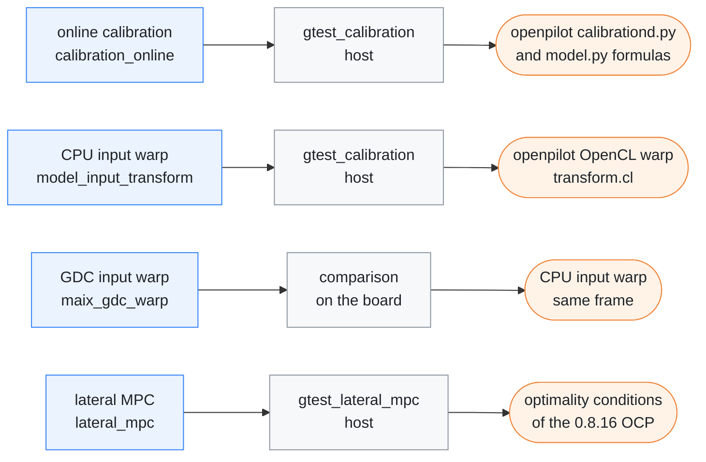
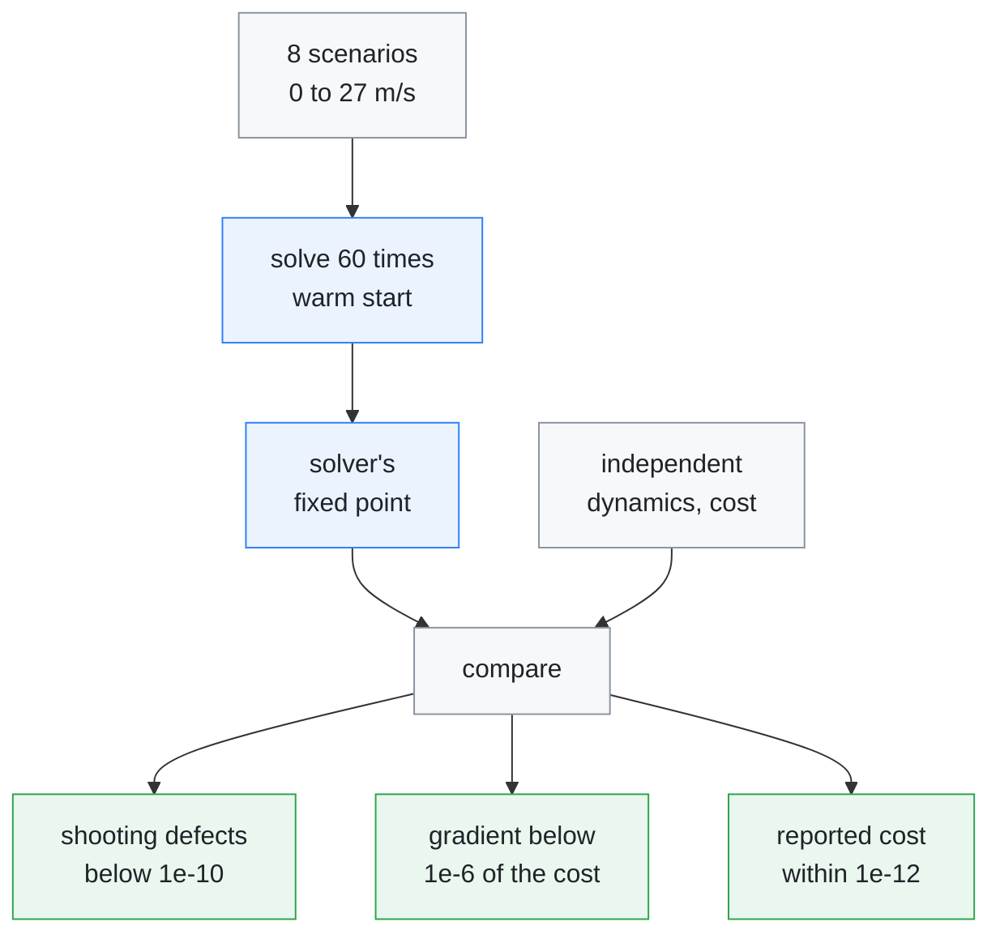
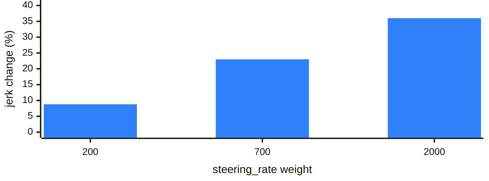

# Verification

[← Documentation](README.md)

How the openpilot math ported to this board is checked: the online calibration
and the model input warp against openpilot's own formulas and OpenCL warp, and
the lateral MPC against the optimality conditions of the problem it solves.
Read it before changing one of these parts; it also records the solver changes
that were measured and rejected.

What each check compares, what it compares against, and where it runs:



## Calibration and input warp

`tests/gtest_calibration.cc` is a host-only verifier for the openpilot-derived
calibration and input-warp math. It needs neither the AX runtime nor the
MaixCAM2 SDK. It covers the CPU warp and the projection matrices the GDC warp
is given; the GDC itself runs only on the board.

### What the host test checks

- The pose-based calibration state machine.
- The manual-vs-online feedback policy.
- The medmodel and sbigmodel homography matrices. The verifier checks the
  ISP-normalised medmodel defaults and compares its matrix with the original
  openpilot formula.
- The UV `transform_scale_buffer(0.5)` handling.
- The YUV6 plane order (`Y00, Y10, Y01, Y11, U, V`).
- With zero rpy, the warped YUV6 must equal a direct (unwarped) pack byte for
  byte.

### Conventions kept from openpilot

- **Roll-free feedback.** The verifier intentionally treats model-input
  feedback as roll-free, matching openpilot's
  `get_view_frame_from_road_frame(0, pitch, yaw, model_height)` extrinsic
  matrix. `rpyCalib` may contain a tiny roll internally in openpilot, but that
  roll is not fed into `modeld`.
- **Acceptance gate.** Automatic calibration requires both CAN `vEgo` and
  camera-odometry `trans[0]` above 15 mph, matching openpilot's acceptance gate.
- **Both towers.** The final graph keeps both visual towers live. `input_imgs`
  uses the 910-pixel-focal medmodel virtual camera and `big_input_imgs` uses
  the 455-pixel-focal sbigmodel virtual camera, matching the single-camera C2
  path.

### Measured differences

- **CPU warp against OpenCL.** Against openpilot's OpenCL interpolation on a
  `640x360` source frame, the worst 12-case mean absolute pixel difference of
  the CPU warp is `0.314/255` and the worst absolute difference is `7/255`. The
  paths use the same projection and YUV6 layout, but are not bit-exact:
  openpilot quantises coordinates to 1/32 pixel with 15-bit coefficients, while
  this warp uses 12-bit coefficients.
- **GDC against CPU.** On the board, the GDC warp matches the CPU warp to
  1 LSB in Y and 0.4 LSB on average in U/V.
- **Model output.** On a replay, the plan lateral offset at 2 s differs from
  the fp32 host reference by 0.0005 m.

### Run it alone

`scripts/run_host_tests.sh` already runs this verifier. To run it alone:

```sh
cmake -S . -B build-host \
  -DCMAKE_BUILD_TYPE=Release \
  -DEDGEPILOT_BUILD_RUNTIME=OFF \
  -DEDGEPILOT_BUILD_DIAGNOSTICS=ON
cmake --build build-host --target gtest_calibration -j2
build-host/bin/gtest_calibration
```

## Lateral MPC solver

`src/planning/lateral_mpc.*` solves the same OCP as openpilot 0.8.16's acados
`lateral_mpc_lib`. The problem was recovered from the generated solver's own
`.rodata` and cross-checked against openpilot's `lat_mpc.py`:

| Part | Value |
| --- | --- |
| Shooting nodes | `T_IDXS`, 16 intervals over 2.5 s |
| Bounded states | `idxbx=[2,3]`, at radians(90) and radians(50) |
| Residuals | `NONLINEAR_LS`: `(y, (v+5)*psi, (v+5)*4*rate)` |
| Integrator | ERK4, one step per interval |
| Hessian | Gauss-Newton |
| Cost | scaled per stage by the time step |

Two deliberate reductions:

- **No `x_ego` state.** It appears in no cost term, no constraint, and no other
  state's dynamics, so the solver state is `(y, psi, curvature)`.
- **One iteration, solved exactly.** One Gauss-Newton SQP iteration per call,
  with the LQ subproblem solved exactly by a backward Riccati recursion. This is
  the same real-time-iteration structure as acados' `SQP_RTI` with
  `qp_solver_iter_max = 1`, but the subproblem is solved to optimality instead
  of by a single interior-point step.

### Optimality check

The check runs on the host with no second solver. `tests/gtest_lateral_mpc.cc`
reimplements the dynamics and cost independently and checks the warm-started
fixed point across eight scenarios (standstill through 27 m/s):



The test requires the multiple-shooting defects to stay below `1e-10`, and the
central-difference gradient of the true objective below `1e-6` relative to the
cost. Measured, they stay below `2e-15` and `2e-9`. A wrong sensitivity in the
RK4 forward VDE fails this check, since the iteration would then settle where
the linearised KKT holds but the true gradient does not.

### Steering-rate cost term (from 0.9.4)

openpilot 0.9.4's lat MPC splits the input cost into lateral-jerk and
steering-rate terms. Its steering-rate residual, `psi_accel / (v_ego + 0.1)`,
is the same quantity as this solver's `curvature_rate`, so the shipped weight
of 700 transplants directly. All three of 0.9.4's extra terms were implemented
and swept over three recorded drive segments; only this one earned its place:

| Term | Effect at a sane weight | Verdict |
| --- | --- | --- |
| `steering_rate` (700) | command jerk -24.6% overall, -27.1% below 20 km/h | kept |
| `lateral_jerk` (0.04) | -2.8%; it is the existing `rate` term with a different speed scaling | dropped as redundant |
| `lateral_accel` (0.02) | -0.0%; at a weight large enough to matter it distorts highway cornering | dropped |

Command jerk (RMS of `d(des)/dt` from `replay_planner`) with `steering_rate` at
700, by speed band:

| Segment | 0-5 km/h | 5-20 | 20-50 | 50+ |
| --- | --- | --- | --- | --- |
| 000 | -42% | **+23%** | -14% | -3% |
| 007 | -61% | -40% | -8% | -4% |
| 008 | -46% | -31% | -13% | -3% |

Fourteen of the fifteen bands improve. The exception is a creep window of about
5 s in segment 000 (103 frames, 5-20 km/h) where the model plan is collapsed to
8-18 m and its references jump frame to frame. There the rate penalty makes the
solver lag a jumping reference and the command gets rougher. The effect scales
monotonically with the weight, so it is a dial rather than a threshold. The
change in command jerk in that window, by weight:



Halving the weight to 400 halves that regression and keeps most of the benefit.
`mpcSolutionValid` and laneless mode never differ, and the command deviation
from the pre-term baseline stays under 4.1e-3 1/m, confined to below 20 km/h
(7e-5 1/m above 50 km/h).

The term is one extra weight in the input Hessian, so a solve costs the same.

### Rejected: more than one SQP iteration per cycle

Since a solve is cheap, running 2-3 SQP iterations per cycle looked like free
tracking accuracy. It buys nothing, because the NLS residuals are *linear* in
the state and control at a fixed speed. The Gauss-Newton Hessian is therefore
exact, and the only nonlinearity in the whole problem is `sin/cos(psi)` at
`|psi| < 0.05 rad`. One Newton step lands on the optimum.

This was measured against the same frame solved to convergence, over a
200-cycle 20 Hz sequence with a sinusoidal reference plus a 3.5 m lane-change
step. The controller consumes only `curvatures[0]` and `psis` interpolated at
the actuator delay. `curvatures[0]` is fixed to the passed value by the
initial-state equality, so it is identical by construction; the gap in `psis`
is reported as the equivalent curvature error `dpsi / (v * delay)`:

| v | 1 iteration | 2 | 3 |
| --- | --- | --- | --- |
| 3 m/s | 5.3e-6 | 6.8e-8 | 9.4e-10 |
| 12 m/s | 2.5e-6 | 1.3e-8 | 8.6e-11 |
| 27 m/s | 4.5e-7 | 7.2e-10 | 1.3e-12 |

Cold start immediately after `reset()` is the same order (2.8e-6 at 3 m/s), so
the failure-recovery path needs no extra iterations either. For scale, one
iteration's residual suboptimality is about 2500 times smaller than the command
range. `curvature_rates` are logged but never consumed by the controller.

### Rejected: per-node speed profile

0.9.4 passes the model's predicted speed profile per shooting node. This was
implemented and measured, then reverted.

- **The profile is real.** In a creep window the model correctly predicts
  3.4 → 1.4 m/s over the horizon while the plan only reaches 7.9 m, so the
  flat-speed assumption was clamping references to the last knot.
- **The only source is unstable.** Without a recording-format change, the speed
  can only come from differentiating the plan's arc length, and that is
  unstable frame to frame at low speed: the estimated speed jumped
  3.7 → 1.5 m/s between two frames 0.1 s apart.
- **Result.** Command jerk rose 1.3-1.8 times on the two standstill-heavy
  segments, and a physical acceleration-band clamp (±2.5 m/s² × t) only
  recovered half of it.

Revisit it with the model's velocity head (plan knot floats 3-5, currently
unparsed), which needs `ModelState` to grow and the recording version to be
bumped.

## Host self-tests

The googletest binaries under `tests/` need no board;
`scripts/run_host_tests.sh` runs them all through `ctest`. What each one covers
is listed in [Host tests](../tests/README.md). The standalone tools, host and
on-board, are listed in [Diagnostic tools](../diagnostics/README.md).

## Related

- [Host tests](../tests/README.md): what each host test covers and how to add
  one
- [Diagnostic tools](../diagnostics/README.md): `replay_planner` and the other
  replay tools used for the measurements above
- [Model pipeline](model-pipeline.md): the input warp, the GDC and the NPU on
  the board
- [Diagnostics](diagnostics.md): procedures and results of the replay tools
- [Source layout](source-layout.md): where the calibration, warp and MPC code
  live
