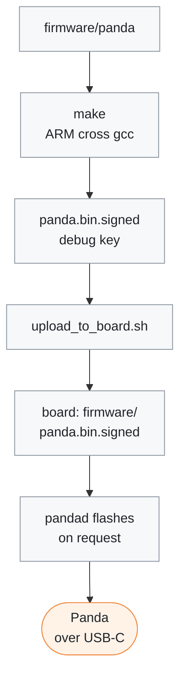
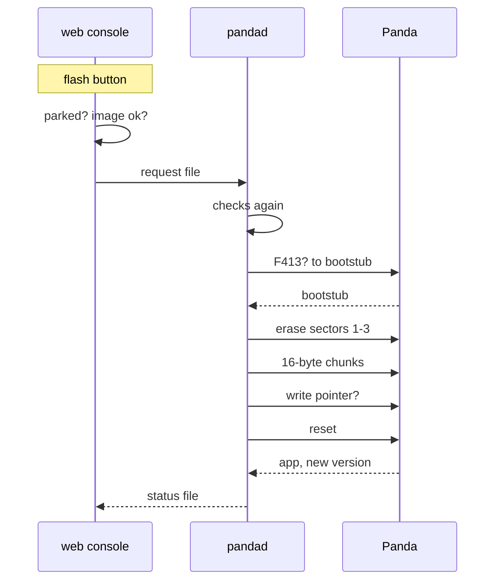

# Panda firmware

[← Documentation](../../docs/README.md)

The firmware the car's Panda runs, built for the STM32F413 boards (black
panda, uno, dos). It lives next to `pandad` because `pandad` speaks its USB
protocol: health packet version 7, CAN packet version 2, and the
`hyundaiCommunity` safety mode (24).

From the sources here to the Panda in the car:



## Origin

- comma.ai's [panda](https://github.com/commaai/panda) firmware (MIT, see
  `LICENSE`), the health v7 / CAN v2 generation, as crwusiz imported it into
  [openpilot_c2](https://github.com/cwal1220/openpilot_c2) (`9eb3fb5`).
- One local change from openpilot_c2 (`0789b03`): the Black Panda's USB power
  and harness relay follow the ignition, checked once a second.
  - With the ignition on, USB is in CDP mode and the relay intercepts the
    camera's CAN.
  - When the ignition goes off, USB returns to client mode at once, and the
    relay reconnects the camera after two checks in a row see it off
    (debounced against glitches on the ignition line).
- Only what the F413 build compiles was imported: the firmware and its
  bootstub, the `hyundai`, `hyundai_community`, `defaults` and `elm327` safety
  modes, the F413 CMSIS headers, the RSA/SHA code the bootstub verifies
  signatures with, the signing script and the keys. The H7 (red panda) and
  pedal targets, the other safety modes, the Python host library, docs and
  examples were left out.

`git log firmware/panda` starts with the import and the local change, so every
later difference from openpilot_c2 is a commit here.

## Build

```sh
make -C firmware/panda
```

This writes `obj/panda.bin.signed` (the application), `obj/bootstub.panda.bin`
and `obj/version`. It needs only `arm-none-eabi-gcc` and `python3`: the build
is freestanding (no newlib) and signs with the standard library.

- On Ubuntu, including the board, install `gcc-arm-none-eabi` with apt; on
  macOS, Homebrew's `arm-none-eabi-gcc`.
- Built with the same compiler, the output is byte-identical to openpilot_c2's
  SCons build of the same sources.
- `tools/docker_ax630/build.sh` builds it next to the runtime, into
  `build-ax630/panda/obj/` (`make OBJ=<dir>/obj` puts the output anywhere),
  with the build image's `gcc-arm-none-eabi` 10.3, the one the board's apt
  installs. `scripts/upload_to_board.sh` copies the image to the board.

Builds are signed with the debug key in `certs/`, so they run only on a Panda
whose bootstub accepts debug signatures. A Panda that already runs a debug
build (its version ends in `-DEBUG`) has such a bootstub.

## Version

The firmware reports its version over USB (request `0xd6`).
`panda_version.py` names a build `EDGE-<8 hex>-DEBUG` from the SHA-256 of
everything that shapes it: `board/`, `crypto/`, `certs/`, the `Makefile` and the
script itself. It is computed from file contents, so a checkout and a copy on
the board agree. openpilot_c2 built every version as `DEV-23456789-DEBUG`.

## Flashing

The board flashes the Panda over the USB-C port it is already on, with the image
`upload_to_board.sh` installs as `firmware/panda.bin.signed` in the install
directory (`EDGEPILOT_PANDA_FIRMWARE` overrides the path).

The web console's device settings tab has a Panda firmware card: the version
the Panda runs, the installed image, and a flash button.

- **Parked only.** The button works only with the car parked: a fresh control
  state, the vehicle state alive, steering and engagement off, in P and
  standing still.
- **Checked twice.** The web console checks that and writes the image's
  version to `/dev/shm/edgepilot_panda_flash`. `pandad` checks it again,
  closes its own Panda connection and flashes, reporting progress through
  `/dev/shm/edgepilot_panda_status.json`.

> [!WARNING]
> A flash takes about 10 s. The Panda reboots twice, the harness relay falls
> back to the stock camera wiring, and steering control stops.

A flash from the button, step by step (`src/panda/panda_flasher.cc`):



What the flasher does:

1. On the application, check the board is an F413 one and ask the firmware to
   reboot into its bootstub; wait for the bootstub to enumerate.
2. Check the bootstub's flasher answers, unlock the flash and erase sectors 1–3,
   the 48 KB application area.
3. Write the image to the flasher's endpoint in 16-byte chunks, then check the
   bootstub's write pointer stopped exactly at the end of the image.
4. Reset, wait for the application to enumerate, and check it reports the
   image's version.

With the runtime stopped, `panda_flash` in the install directory does the same
from a shell: without `--yes` it only shows the image and the Panda.

The bootstub never erases sector 0, where it lives. So a flash that stops
halfway, or an image whose signature it rejects, leaves the Panda in its
bootstub and still flashable: the card then shows `bootstub` and offers to
write the firmware again.

## Related

- [K7 Panda port](../../docs/k7-panda-port.md): how `pandad` uses the Panda,
  the K7's CAN buses and the TX gates
- [Build and deploy](../../docs/build-and-deploy.md): the container build and
  the upload that carry the image to the board
- [Runtime options](../../docs/runtime-options.md): the web console and its
  device settings
- [Scripts](../../scripts/README.md): `upload_to_board.sh` and the web
  console's Python
