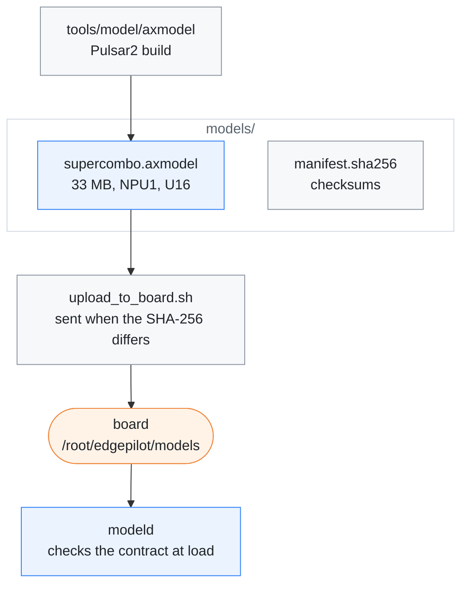

# Model package

[← Documentation](../docs/README.md)

The NPU model the MaixCAM2 runtime runs: the openpilot **master**
`driving_supercombo` core as a Pulsar2 6.0 axmodel for the AX630C, with the
checks that it is right. Read this before replacing the model.

Where the model comes from and where it goes:



## Contents

| File | What it is |
| --- | --- |
| `supercombo.axmodel` | the model `modeld` loads |
| `manifest.sha256` | SHA-256 manifest for the tracked files |
| `.gitignore` | keeps a `work/` folder out of git |

The model runs with U16 activations and uint8 image inputs on the AX630C NPU.
It is compiled for one NPU core (NPU1) because the AI-ISP denoiser always uses
the other. It is built with
[axmodel pipeline](../tools/model/axmodel/README.md), and
`scripts/upload_to_board.sh` puts it on the board as
`/root/edgepilot/models/supercombo.axmodel`.

## Contract

```text
input_imgs          [1, 12, 128, 256]  uint8   road tower, frames t-4 and t
big_input_imgs      [1, 12, 128, 256]  uint8   wide tower, frames t-4 and t
desire              [1, 25, 8]         float   5 Hz max-pooled desire history
features_buffer     [1, 24, 512]       float   5 Hz hidden-state history
traffic_convention  [1, 2]             float
-> 15 outputs (out_meta ... out_desire_state), reassembled into the openpilot
   [2576] layout by src/model/model_output_assembly.h
```

The heads are separate outputs so each gets its own U16 range; the runtime
still accepts a single-output axmodel
([2. Split the outputs](../tools/model/axmodel/README.md#2-split-the-outputs)).
The release graph's `action_t` input is dropped from the core, and the delay it
carries is applied after the model
([1. Extract the core](../tools/model/axmodel/README.md#1-extract-the-core)).

Both image towers are active: the runtime warps one `1280x720` NV12 frame
through two calibrated virtual cameras (`medmodel` fl=910 and `sbigmodel`
fl=455) and keeps a 5-frame history per tower. The queues the released ONNX
keeps in its graph (images, desire, features) are kept on the CPU by
`src/model/model_temporal.h`; the 512-float hidden state at offset 1064 is fed
back through `features_buffer`.

`modeld` verifies this contract at load and refuses any other axmodel, so a
mismatched model fails loudly instead of being misparsed. The output layout is
in [Model output](../docs/model-pipeline.md#model-output).

## Current build

The current build (2026-10-04, sha256 `4ef2b2ab…`) is the split-output core
with Pulsar2 SmoothQuant (U16 activations, S8 conv weights, MinMax
calibration). On the board, against the fp32 core on the same MaixCAM2 inputs,
it is equal to or better than the build before it on every head, and its
gas-press probability reacts at 6 of 8 green-light stops instead of 4
([Check](../tools/model/axmodel/README.md#check)).

- Its calibration set is no longer in this repository, and calibrating on
  MaixCAM2 recordings scored worse. Compare a new build against it on the same
  inputs before replacing it, as in
  [step 5](../tools/model/axmodel/README.md#5-compare-on-the-board).
- The calibration data must carry desire pulses, or the NPU model ignores
  lane-change desire
  ([Troubleshooting](../tools/model/axmodel/README.md#troubleshooting)).

## Verification

On the board, NPU inference takes about 15.5 ms on one core and a whole
`modeld` frame about 19.5 ms.

- On the 552-frame evaluation set the NPU1 model's output is bit-identical to
  the earlier two-core (NPU2) build.
- On a 200-frame replay the board output matched the host axengine runner to
  0.0008 m in plan lateral offset at 2 s, with a hidden-state cosine similarity
  of 0.9994.

The master model replaced v0.9.4 because Pulsar2 6.0 and 7.0 both miscompile
v0.9.4's Elu at U16
([Troubleshooting](../tools/model/axmodel/README.md#troubleshooting)).

## Related

- [Model pipeline](../docs/model-pipeline.md): how `modeld` feeds the model and
  reads its output
- [axmodel pipeline](../tools/model/axmodel/README.md): building and checking a
  new axmodel
- [Build and deploy](../docs/build-and-deploy.md): the upload that copies the
  model to the board
