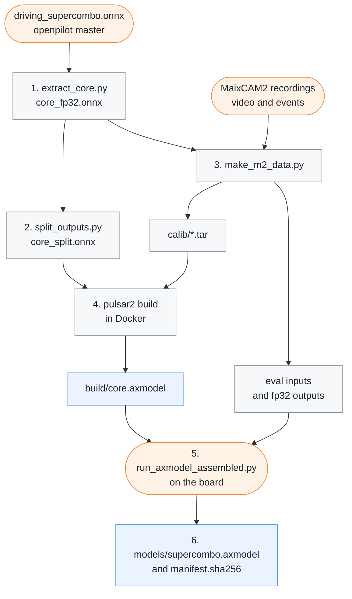

# axmodel pipeline

[← Documentation](../../../docs/README.md)

How `models/supercombo.axmodel`, the model the MaixCAM2 runtime runs
(`src/model/supercombo_model.cc`), is built from openpilot master's released
`driving_supercombo.onnx`. Only the network core goes onto the NPU; its input
queues (the image, desire and feature shift registers) are cut off, and the
runtime keeps them on the CPU (`src/model/model_temporal.h`).



Run the scripts from this folder in the host environment of
[Model tools](../README.md#host-environment).

## 1. Extract the core

Needs `onnx`.

```sh
python3 extract_core.py driving_supercombo.onnx core_fp32.onnx
```

The released graph also holds the history queues (the image, desire and feature
shift registers, and the 20 → 5 Hz desire max-pool). They are cheap tensor
shuffles that the runtime does on the CPU, so the core keeps only the network:

```text
input_imgs          [1, 12, 128, 256]  2 frames x 6 YUV planes (road)
big_input_imgs      [1, 12, 128, 256]  the same for the wide tower
desire              [1, 25, 8]         desire history, max-pooled to 5 Hz
features_buffer     [1, 24, 512]       feature history at 5 Hz
traffic_convention  [1, 2]
-> outputs          [1, 2576]
```

The script promotes fp16 weights and casts to fp32, because Pulsar2 quantises
from fp32. It makes every input an fp32 graph input under the runtime's name
(the image inputs were uint8; Pulsar2 makes them uint8 again in step 4). It
rewrites the ops Pulsar2 does not accept into ones that give the same values:

| Op in the release | Problem | Rewritten as |
| --- | --- | --- |
| opset-20 `Cast` | Pulsar2 does not accept it | bypassed; after the promotion every Cast is fp32 to fp32 |
| `Identity` | Pulsar2 7.0 does not accept a lone Identity link | bypassed |
| `GatherND` with constant indices (the last 9 feature tokens) | Pulsar2 cannot run it | `Slice` |
| `Where(mask, -inf, x)`, the attention mask | Pulsar2 cannot run it | `Add` of −30 where masked |
| 2D `LpNormalization` (Pulsar2 fuses `x / expand(clip(ReduceL2(x)))` into it) | the AX620E backend tiles it only in 3D or 4D | the two `[1, 512]` L2 normalisations run on a `[1, 1, 512]` view |

Attention scores measured on recorded drives lie in [−6.3, 4.7], so −30 leaves
a masked weight below e⁻¹⁹ and keeps the quantisation range narrow. Filling
with −inf or −1e4 ruins the range.

The released graph (sha256 `65a08adc…`, the model openpilot master ships as of
2026-09-23) also takes `action_t`, the lateral and longitudinal delay
openpilot's modeld feeds in, but only into a `Cast` whose result nothing reads.
It cannot change the outputs, so the core drops it. The runtime applies the
delay after the model instead, in the laneless curvature law and the torque
controller, as openpilot does. If a newer graph lets `action_t` reach the
outputs, the script stops: such a model needs a new core input and runtime
support.

## 2. Split the outputs

Needs `onnx`.

```sh
python3 split_outputs.py core_fp32.onnx core_split.onnx
```

The core joins its 13 heads with one Concat, and Pulsar2 quantises a tensor
with one U16 scale. So every value got the step of the widest head, about 0.007
(plan x reaches about 200 m). That is fine for positions, but not for the plan
yaw and yaw rate, a few mrad on a straight road. They came out as 0 or ±0.007,
and the laneless curvature law 2ψ/(v·t) jumped by about 0.6 m/s² per step
(2026-09-29 road test: the steering wobbled left and right).

The script removes the Concat and makes every head a graph output. The policy
used to slice the hidden state back out of the vision Concat; it now reads the
hidden head directly. The plan head (a 990x256 Gemm, then a Mul by a scale per
row) is split by rows into three Gemms, so the small orientation columns get
their own range:

| Output | Plan values | Size |
| --- | --- | --- |
| `out_plan_motion` | mean columns 0-8: position, velocity, acceleration | 33 x 9 |
| `out_plan_orient` | mean columns 9-14: Euler angles, orientation rate | 33 x 6 |
| `out_plan_std` | the log stds | 495 |

That makes 15 outputs. `src/model/model_output_assembly.h` puts them back into
the 2576 layout; its names and row order match this script. The Pulsar2
config's `input` is `core_split.onnx`.

## 3. Build calibration and evaluation data

Needs `onnxruntime`.

```sh
python3 make_m2_data.py calib m2_calib_20261004.json calib
```

This writes `calib/<tensor>.tar`, float32 `.npy` samples for Pulsar2. Every
sample is what the board feeds the core:

- the recorded H.264 frame (1280x720) through the device warp
  (`../model_warp.py`, the MaixCAM2 intrinsics, the recorded calibration and
  camera mount; see [Model tools](../README.md#model_warppy));
- the t−4 and t images of each tower's 5-frame history;
- the desire pulses `controlsd` sent (rising edges, 100 ticks max-pooled to 25);
- the core's own 96-tick hidden-state history, from running the fp32 core in
  order.

The spec names the inputs and the sampling:

| Key | What it is |
| --- | --- |
| `core` | the fp32 core, `core_fp32.onnx` |
| `routes_dir` | where the recorded routes are, each with its `events/` and `segments/` |
| `groups` | runs of consecutive segments, each decoded as one stream |
| `exclude` | per route, moments whose t−12 to t+5 s are left out (the evaluation moments) |
| `dense` | per route, time ranges sampled densely (changes of light) |
| `stride`, `dense_stride` | frames between samples, 80 and 5 |

Every fourth sample gets one synthetic desire pulse, so the desire range stays
[0, 1] ([Troubleshooting](#troubleshooting)).

The same tool's `eval` makes the inputs for a board comparison:

```sh
python3 make_m2_data.py eval m2_calib_20261004.json <route> <seg>[,<seg>...] <from> <to> <out_dir>
```

It writes the inputs of every frame from `<from>` to `<to>` (route seconds from
the first `ControlState`) as one frame-major `.npy` per input, with the fp32
outputs for the same inputs (`ref.npy`) and the frame times (`t.npy`).

## 4. Compile with Pulsar2

Use Pulsar2 6.0-lite in Docker (amd64). Mount the working directory, holding
`core_split.onnx` and `calib/`, as `/data` and run:

```sh
pulsar2 build --config /data/pulsar2_u16_u8in.json
```

The result is `build/core.axmodel`. The config `pulsar2_u16_u8in.json` sets:

| Setting | Value |
| --- | --- |
| `target_hardware`, `npu_mode` | AX620E, NPU1: one NPU core, because the AI-ISP denoiser uses the other |
| `layer_configs` | U16 everywhere; conv weights are S8, because AX620E ignores an FP32 weight setting |
| `calibration_method` | MinMax |
| `enable_smooth_quant` | on (SmoothQuant) |
| `input_processors` | uint8 image inputs, fp32 for the rest |

## 5. Compare on the board

Run the new axmodel over an `eval` set on the board with pyaxengine. Stop
`edgepilot.service` first: `modeld` holds the NPU core.

```sh
python3 run_axmodel_assembled.py <model.axmodel> <input_dir> <out.bin>
```

It runs the model open loop and writes each frame's output as the 2576 floats
of the original layout. A split build is reassembled the way
`src/model/model_output_assembly.h` does it, so single-output and split builds
are compared with the same measures against `ref.npy` (the runtime takes only
split builds).

Compare a new build against the shipped one on the same inputs before replacing
it. The shipped build was calibrated on an earlier sample set that is no longer
in the repository. In the comparison of 2026-10-04, calibrating on MaixCAM2
recordings widened the MinMax ranges and scored worse than the shipped build.

## 6. Replace the model

Copy `build/core.axmodel` into the repository as `models/supercombo.axmodel`
and update `models/manifest.sha256`. `scripts/upload_to_board.sh` then sends it
to the board.

## Check

The split build of 2026-09-29, on the board over the 552-frame evaluation set
against fp32:

| Measure | Single output | Split outputs |
| --- | --- | --- |
| Laneless target lateral-acceleration error, mean | 0.109 m/s² | 0.054 m/s² |
| Laneless target lateral-acceleration error, p95 | 0.35 m/s² | 0.22 m/s² |
| Distinct plan yaw values | 12 | 568 |

Lane lines, leads and plan positions did not change.

SmoothQuant (`enable_smooth_quant`) moves the activation outliers of 124 convs
into their weights before the U16/S8 quantisation. It was compared on
2026-10-04, on the board against fp32 on the same MaixCAM2 inputs (12 driving
windows and 8 green-light stops). It is equal to or better on every head, and
that build (sha256 `4ef2b2ab…`) is the one in `models/`:

| Measure | Without | With SmoothQuant |
| --- | --- | --- |
| Laneless lateral-acceleration error on MaixCAM2 drives, mean | 0.020 m/s² | 0.018 m/s² |
| Laneless lateral-acceleration error on MaixCAM2 drives, p95 | 0.063 m/s² | 0.057 m/s² |
| Hidden-state cosine | 0.947 | 0.952 |
| Green lights: gas-press probability passes 0.3 within 0.25 s | 4 of 8 stops | 6 of 8 stops |

The fp32 core opens its plan at two of the stops where no U16 build does.

NPU inference on the board takes about 15.5 ms on one core.

## Troubleshooting

- **The model ignores lane-change desire.** The calibration data's desire must
  carry pulses; `make_m2_data.py` adds a synthetic pulse to every fourth sample
  on top of the recorded ones. An earlier model was calibrated with zeros only,
  so its desire input range was [0, 0] and the NPU model did not react to a lane
  change at all. On 2026-09-27 on the board, with a pulse fed in,
  laneChangeLeft was 0.00 for the old model and 0.99 for the new one. Without
  desire the outputs are the same (plan y differs by 0.0006 m).
- **Options that do not work.** `highest_mix_precision` does not build, and
  EasyQuant needs more than Docker's 9.7 GB of memory.
- **Elu.** Pulsar2 6.0 and 7.0 both miscompile Elu at U16, which broke the
  0.9.4 model. That is why the runtime moved to the master model.

## Related

- [Model package](../../../models/README.md): the shipped build, its contract
  and board results
- [Model pipeline](../../../docs/model-pipeline.md): how the runtime feeds the
  core and reassembles its outputs
- [Model tools](../README.md): the host environment, the recording reader and
  the numpy warp
